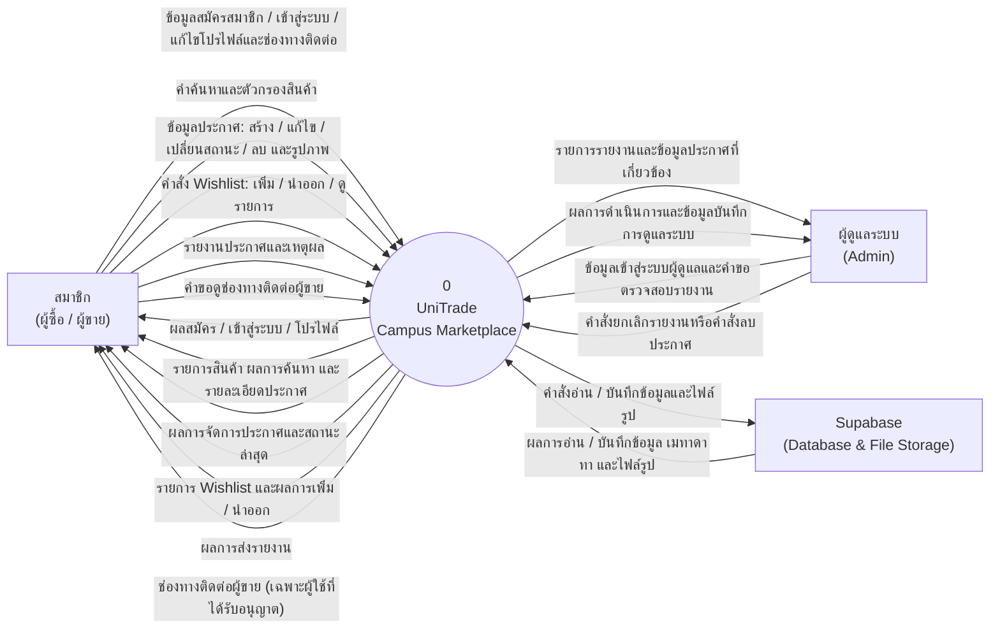

# UniTrade — Context Diagram

**Notation:** Data Flow Diagram (DFD), Context Diagram / Level 0  
**System boundary:** UniTrade campus marketplace application and its business logic.  
**Purpose:** Show the external parties and services that exchange information with UniTrade. Internal processes, database tables, and API endpoints are intentionally omitted at this level.

## External entities and data flows

| External entity | Information sent to UniTrade | Information received from UniTrade |
|---|---|---|
| **สมาชิก (ผู้ซื้อ / ผู้ขาย)** | Registration and login details; profile and contact-channel updates; search criteria; listing content and images; listing changes; Wishlist actions; product reports; requests for seller contact details. | Authentication and profile results; product lists, search results, and details; listing and status results; Wishlist contents and action results; report result; seller contact channels when authorized. |
| **ผู้ดูแลระบบ (Admin)** | Admin sign-in details; requests to review reports; commands to dismiss a report or delete a listing. | Reports and related listing information; moderation action results and audit information. |
| **Supabase (Database & File Storage)** | Data read/write requests and image-file operations from UniTrade. | Query/write results, stored data and metadata, and image-file results. |

## Notation and scope notes

- The numbered circle is the single **context process**; `0` identifies the UniTrade system at this level.
- Rectangles represent **external entities/services**. Directed, labeled arrows represent **data flows**; paired arrows show two-way exchanges.
- Supabase is shown as an external service dependency. Its tables, storage buckets, and internal operations are not expanded here.
- Seller contact information is returned only through the authorized contact flow; public product browsing does not include private contact channels.
- UniTrade does not provide in-app chat, payments, or shipping. These are outside this system boundary.
- This diagram describes the target scope across the listed tasks. It is not a claim that every depicted feature has already been implemented; in particular, Wishlist and the contact API are not currently present in the repository.
