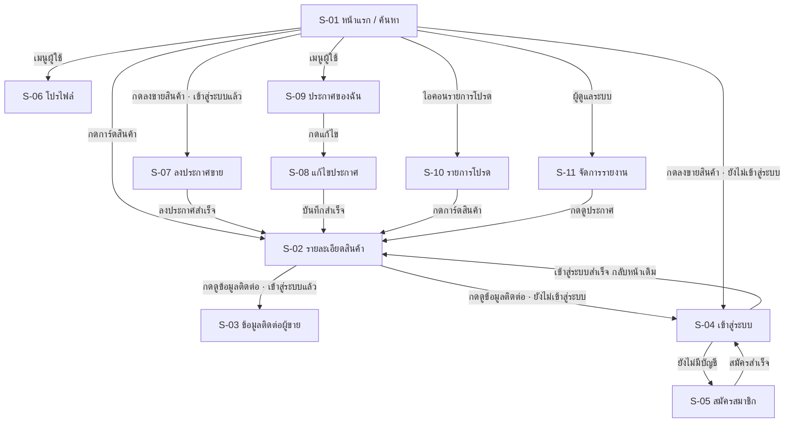

# เนื้อหาสำหรับรายงาน — ส่วนที่ฝั่งหน้าเว็บรับผิดชอบ

เขียนตามโครงใน `ReportSE-1309` ที่ @Snow212 แชร์ไว้ในกลุ่ม (29 ต.ค.) ไว้ให้ยกไปวางในเล่มรายงานได้เลย
ผู้เขียน: ยัต (Frontend Lead / System Designer ส่วนส่วนต่อประสานผู้ใช้) · อัปเดต 3 พฤศจิกายน 2569

หัวข้อที่อยู่ในไฟล์นี้: **4.6** (เต็มหัวข้อ) · **5.1** (เฉพาะส่วนหน้าเว็บ) · **5.2–5.3** (เฉพาะส่วนหน้าเว็บ)
หัวข้ออื่น (4.2 สถาปัตยกรรม, 4.5 ฐานข้อมูล, 4.7 ความปลอดภัย, บทที่ 1–3) เป็นของคนอื่น — ไม่ได้เขียนไว้ที่นี่

> หมายเหตุสำหรับคนรวมเล่ม: ตรงที่เขียน `[FR-xx]` ยังต้องเติมเลข FR ให้ตรงกับ SRS ฉบับจริง (TASK-01) ผมอ้างเฉพาะ FR-06 ที่มั่นใจ และอ้าง UC-01 ถึง UC-07 ตาม sequence diagram ของ TASK-03

---

# 4.6 การออกแบบส่วนต่อประสานผู้ใช้ (User Interface Design)

## 4.6.1 แนวคิดการออกแบบ

UniTrade ออกแบบโดยยึดสามข้อนี้ ซึ่งมาจากข้อสรุปการเก็บข้อมูลในบทที่ 2 ว่าผู้ใช้เดิมซื้อขายกันผ่านกลุ่มใน Facebook และ Twitter ซึ่งค้นหาของย้อนหลังไม่ได้และไม่รู้ว่าของขายไปแล้วหรือยัง

1. **เห็นของได้เร็วที่สุด** — หน้าแรกคือหน้าค้นหา ไม่ต้องล็อกอินก่อนก็ดูของได้ ผู้ใช้ที่เพิ่งเข้าเว็บเห็นสินค้าจริงทันทีโดยไม่ต้องกดอะไร
2. **รู้สถานะของทุกชิ้นตั้งแต่ในตาราง** — ป้ายสถานะ พร้อมขาย / ติดจอง / ขายแล้ว อยู่บนการ์ดสินค้าเลย ไม่ต้องกดเข้าไปดูทีละชิ้นเหมือนการเลื่อนหาในโพสต์เก่า
3. **ข้อมูลติดต่อเป็นของสมาชิกเท่านั้น** — เบอร์โทรและ LINE ID ของผู้ขายไม่แสดงในหน้าใด ๆ จนกว่าผู้ใช้จะล็อกอินด้วยอีเมลจุฬาฯ แล้วกดปุ่มขอดูเอง (FR-06)

ส่วนต่อประสานใช้ภาษาไทยทั้งหมด รวมถึงข้อความแจ้งข้อผิดพลาด เพราะกลุ่มเป้าหมายคือนิสิตและบุคลากรจุฬาฯ

## 4.6.2 โครงสร้างส่วนต่อประสานผู้ใช้ (User Interface Structure)

ทุกหน้าใช้โครงร่วมกันสามชั้น

| ชั้น | เนื้อหา | แสดงที่ |
|---|---|---|
| ส่วนหัว (Navbar) | โลโก้ · ช่องค้นหา · ปุ่มลงขายสินค้า · รายการโปรด · ปุ่มเข้าสู่ระบบ หรือเมนูผู้ใช้ | ทุกหน้า ติดขอบบนตลอด สูง 64 px |
| ส่วนเนื้อหา | เปลี่ยนไปตามหน้า กว้างสูงสุด 1200 px จัดกลางจอ | ทุกหน้า |
| ส่วนท้าย (Footer) | ชื่อโปรเจกต์ · ลิงก์หมวดหมู่ · ข้อความเตือนเรื่องความปลอดภัยในการนัดรับ | ทุกหน้า |

ส่วนหัวเปลี่ยนรูปตามสถานะการเข้าสู่ระบบสามแบบ คือ กำลังตรวจสอบ (แสดงกรอบเทารอ) · ยังไม่เข้าสู่ระบบ (แสดงปุ่มเข้าสู่ระบบ) · เข้าสู่ระบบแล้ว (แสดงชื่อผู้ใช้และเมนูย่อย) การแยกสถานะ "กำลังตรวจสอบ" ออกมาทำให้ปุ่มไม่กระพริบสลับไปมาตอนเปิดหน้าใหม่

**รายการหน้าจอทั้งหมดของระบบ**

| # | หน้าจอ | ที่อยู่ | หน้าที่ | ต้องเข้าสู่ระบบ |
|---|---|---|---|---|
| S-01 | หน้าแรก / ค้นหาสินค้า | `/` | แสดงสินค้าเป็นตาราง ค้นหา กรอง เรียงลำดับ แบ่งหน้า | ไม่ |
| S-02 | รายละเอียดสินค้า | `/products/[id]` | รูปทั้งหมด ข้อมูลสินค้า ข้อมูลผู้ขายแบบย่อ ปุ่มขอข้อมูลติดต่อ | ไม่ (ปุ่มติดต่อต้อง) |
| S-03 | ข้อมูลติดต่อผู้ขาย | หน้าต่างซ้อนบน S-02 | LINE ID และเบอร์โทร พร้อมลิงก์กดต่อ และคำเตือนความปลอดภัย | ใช่ |
| S-04 | เข้าสู่ระบบ | `/login` | อีเมลจุฬาฯ + รหัสผ่าน | ไม่ |
| S-05 | สมัครสมาชิก | `/register` | ข้อมูลผู้ใช้ คณะ ช่องทางติดต่อ | ไม่ |
| S-06 | โปรไฟล์ | `/me/profile` | แก้ข้อมูลส่วนตัวและช่องทางติดต่อ | ใช่ |
| S-07 | ลงประกาศขาย | `/products/create` | ฟอร์มสินค้า + อัปโหลดรูป 1–5 รูป | ใช่ |
| S-08 | แก้ไขประกาศ | `/products/[id]/edit` | แก้ข้อมูลประกาศของตัวเอง | ใช่ (เจ้าของ) |
| S-09 | ประกาศของฉัน | `/me/products` | รายการประกาศของตัวเอง + เปลี่ยนสถานะ + ลบ | ใช่ |
| S-10 | รายการโปรด | `/me/wishlist` | สินค้าที่กดบันทึกไว้ | ใช่ |
| S-11 | จัดการรายงาน | `/admin` | ผู้ดูแลตรวจรายงานและลบประกาศที่ไม่เหมาะสม | ใช่ (ผู้ดูแล) |
| S-12 | ไม่พบหน้า | ที่อยู่ที่ไม่มีในระบบ | แจ้งว่าหน้านี้ถูกย้าย ลบ หรืออยู่ระหว่างพัฒนา พร้อมลิงก์กลับหน้าแรก | ไม่ |

สถานะการพัฒนาปัจจุบัน: S-01, S-02, S-03, S-12 และโครงร่วมทุกชั้นพัฒนาแล้ว (TASK-07, 10, 16, 18) · S-04 มีหน้าชั่วคราวไว้ให้การไหลระหว่างหน้าจอทำงานครบ · S-05 ถึง S-11 อยู่ใน TASK-08, 13, 14, 17, 20

## 4.6.3 ผังการใช้งานระหว่างหน้าจอ (Navigation Flow)

จุดที่ตั้งใจออกแบบในผังนี้

- **หน้าแรกคือศูนย์กลาง** ทุกหน้าจอกลับมาที่หน้าแรกได้ด้วยการกดโลโก้บนส่วนหัว ไม่มีหน้าจอใดที่เข้าไปแล้วออกไม่ได้
- **ไม่บังคับเข้าสู่ระบบก่อนดูของ** การเข้าสู่ระบบถูกขอเฉพาะตอนที่ผู้ใช้จะทำสิ่งที่ต้องรู้ตัวตนจริง คือ ขอข้อมูลติดต่อ ลงประกาศ บันทึกรายการโปรด และรายงานประกาศ
- **ขอเข้าสู่ระบบแล้วพากลับที่เดิม** เมื่อระบบพาไปหน้าเข้าสู่ระบบ จะพาผู้ใช้กลับมาหน้าที่กำลังดูอยู่พร้อมสิ่งที่กดค้างไว้ ไม่ทิ้งไว้ที่หน้าแรก เส้นทาง S-02 → S-04 → S-02 ในผังคือเส้นนี้
- **ข้อมูลติดต่อเป็นหน้าต่างซ้อน ไม่ใช่หน้าใหม่** (S-03) ผู้ใช้จึงยังเห็นสินค้าที่กำลังสนใจอยู่ข้างหลัง และปิดกลับมาอ่านรายละเอียดต่อได้ทันที

## 4.6.4 ธีมที่ใช้ออกแบบ

ค่าทุกค่าในธีมถูกประกาศเป็นตัวแปรไว้ที่ไฟล์เดียว (`app/globals.css` ส่วน `:root`) ทุกหน้าจออ้างอิงตัวแปรเหล่านี้ ไม่มีการเขียนรหัสสีลงไปในหน้าจอใดโดยตรง การแก้สีของทั้งเว็บจึงแก้ที่จุดเดียว

**สี**

| บทบาท | ค่า | ใช้กับ |
|---|---|---|
| สีหลัก (แบรนด์) | `#d6608a` ชมพู และไล่เฉดอ่อน–เข้ม 7 ระดับ | ปุ่มหลัก ลิงก์ ตัวกรองที่กำลังเลือก โลโก้ |
| ตัวอักษร | `#1c1c1e` เข้ม · `#3f3f46` รอง · `#6b6b75` จาง | หัวเรื่อง เนื้อหา ข้อความประกอบ |
| เส้นและพื้น | `#e6e6ea` เส้น · `#f4f4f6` พื้นอ่อน · `#ffffff` พื้นหลัก | กรอบการ์ด พื้นหลังส่วนตัวกรอง |
| สถานะ พร้อมขาย | `#15803d` เขียว บนพื้น `#e5f7ec` | ป้ายสถานะบนการ์ดและหน้ารายละเอียด |
| สถานะ ติดจอง | `#b45309` ส้ม บนพื้น `#fff3de` | เหมือนกัน |
| สถานะ ขายแล้ว | `#52525b` เทา บนพื้น `#ececef` | เหมือนกัน |

เลือกใช้สามสีสำหรับสถานะโดยคุมค่าความต่างของแสงระหว่างตัวอักษรกับพื้นให้ผ่านเกณฑ์ WCAG AA (อัตราส่วนความต่างอย่างน้อย 4.5:1) เพื่อให้คนที่แยกสีเขียวกับส้มได้ไม่ชัดยังอ่านข้อความบนป้ายออก และป้ายสถานะทุกอันมีข้อความกำกับเสมอ ไม่ได้ใช้สีสื่อความหมายเพียงอย่างเดียว

**ตัวอักษร** — Noto Sans Thai สำหรับทั้งภาษาไทยและภาษาอังกฤษ เลือกเพราะเป็นแบบอักษรที่ออกแบบให้ความสูงของตัวอักษรไทยและอังกฤษเข้าชุดกัน และรองรับสระกับวรรณยุกต์ซ้อนของภาษาไทยได้ถูกตำแหน่ง ขนาดตัวอักษรเนื้อหา 15 px ระยะห่างบรรทัด 1.6 เท่า หัวเรื่องหนา 600

**รูปทรงและเงา** — มุมโค้งสี่ระดับ (8, 12, 18 px และทรงแคปซูล) เงาสามระดับ ใช้เงาอ่อนสุดกับการ์ดสินค้า และเงาเข้มสุดกับหน้าต่างซ้อน เพื่อให้ลำดับความลึกของผิวหน้าต่าง ๆ ชัด

**ความกว้าง** — เนื้อหากว้างสูงสุด 1200 px จัดกลางจอ ขอบด้านข้างบนมือถือ 16 px

## 4.6.5 รายละเอียดแต่ละหน้าจอ

### S-01 หน้าแรก / ค้นหาสินค้า

รองรับกรณีการใช้งาน UC-04 (ค้นหาสินค้า) แบ่งเป็นสี่ส่วนจากบนลงล่าง

1. **แถบหมวดหมู่** ปุ่มทรงแคปซูลหกหมวด แต่ละปุ่มมีจำนวนสินค้าที่ยังขายอยู่กำกับ เลือกได้หลายหมวดพร้อมกัน และมีปุ่ม "ทั้งหมด" สำหรับล้างการเลือก
2. **แถบเครื่องมือ** ซ้ายบอกจำนวนผลลัพธ์ที่พบ ขวาเป็นตัวเลือกเรียงลำดับสี่แบบ (ใหม่สุด เก่าสุด ราคาน้อยไปมาก ราคามากไปน้อย) บนจอแคบมีปุ่มเปิดตัวกรองเพิ่มขึ้นมาพร้อมตัวเลขบอกจำนวนตัวกรองที่เปิดอยู่
3. **ส่วนตัวกรอง** อยู่เป็นแถบด้านซ้ายบนจอกว้าง ประกอบด้วยหมวดหมู่ ช่วงราคา เฉพาะของแจกฟรี จุดนัดรับ สภาพสินค้า และตัวเลือกแสดงของที่ติดจองหรือขายแล้วด้วย
4. **ตารางสินค้าและการแบ่งหน้า** การ์ดสินค้าสี่คอลัมน์บนจอกว้าง หน้าละ 12 ชิ้น

**การ์ดสินค้า** แต่ละใบแสดงรูปหลัก ชื่อสินค้า (ตัดที่สองบรรทัด) ราคา ป้ายสถานะ จุดนัดรับ และเวลาที่ลงประกาศแบบเทียบกับปัจจุบัน เช่น "3 วันที่ผ่านมา" สินค้าที่ราคาเป็นศูนย์แสดงคำว่า "แจกฟรี" แทนตัวเลข เพราะการแสดง "0 บาท" ทำให้ผู้ใช้สับสนว่าคือของฟรีหรือยังไม่ได้กรอกราคา

### S-02 รายละเอียดสินค้า

ซ้ายเป็นแกลเลอรีรูป โดยรูปหลักอยู่บนสุดและมีรูปย่อเรียงด้านล่างให้กดสลับ ขวาเป็นข้อมูลสินค้า ได้แก่ ป้ายสถานะ ชื่อ ราคา สภาพสินค้า หมวดหมู่ จุดนัดรับ และคำบรรยาย ถัดลงมาเป็นการ์ดผู้ขายที่แสดงชื่อแบบย่อนามสกุล คณะ จำนวนประกาศที่ยังขายอยู่ และระยะเวลาที่เป็นสมาชิก เพื่อให้ผู้ซื้อประเมินความน่าเชื่อถือได้ก่อนติดต่อ ล่างสุดเป็นปุ่มขอดูข้อมูลติดต่อ

สินค้าที่สถานะติดจองหรือขายแล้วจะมีข้อความกำกับเหนือปุ่ม เพื่อไม่ให้ผู้ใช้เสียเวลาติดต่อของที่ไม่ว่างแล้ว แต่ยังเปิดดูหน้านี้ได้ตามปกติ

**ชื่อผู้ขายแสดงเป็นชื่อต้นกับอักษรแรกของนามสกุล** เช่น "กันตภณ ช." เป็นการตัดสินใจร่วมกับฝั่งหลังบ้านว่าข้อมูลที่เปิดเผยต่อสาธารณะควรพอให้จำคนได้เมื่อไปเจอกันจริง แต่ไม่พอให้ค้นหาตัวบุคคลย้อนกลับจากชื่อเต็ม

### S-03 ข้อมูลติดต่อผู้ขาย

เป็นหน้าต่างซ้อนบนหน้ารายละเอียด แสดง LINE ID และเบอร์โทรศัพท์ของผู้ขายเป็นปุ่มที่กดเปิดแอป LINE หรือโทรออกได้ทันที พร้อมย้ำจุดนัดรับที่ผู้ขายเลือกไว้ และคำเตือนความปลอดภัยว่าให้นัดรับในพื้นที่จุฬาฯ ช่วงเวลากลางวัน และตรวจสอบสินค้าก่อนชำระเงินทุกครั้ง

ระบบจะดึงข้อมูลติดต่อ **ตอนที่ผู้ใช้กดปุ่มเท่านั้น** ไม่ได้ดึงมารอไว้พร้อมหน้ารายละเอียด เพื่อให้ข้อมูลติดต่อไม่เคยปรากฏอยู่ในข้อมูลที่ส่งมาแสดงหน้าเว็บของผู้ที่ยังไม่ได้ล็อกอินเลย ซึ่งเป็นการบังคับใช้ FR-06 ตั้งแต่ชั้นการออกแบบ ไม่ใช่แค่ซ่อนด้วยการแสดงผล

### S-12 ไม่พบหน้า

ใช้กับที่อยู่ที่ไม่มีในระบบและสินค้าที่ถูกลบไปแล้ว แสดงข้อความว่าหน้านี้อาจถูกย้าย ถูกลบ หรืออยู่ระหว่างการพัฒนา พร้อมปุ่มกลับหน้าแรก ออกแบบไว้เพราะช่วงพัฒนามีหน้าที่ยังไม่เสร็จอยู่หลายหน้า การให้ผู้ใช้เห็นหน้าที่อธิบายได้ดีกว่าหน้าข้อผิดพลาดของเครื่องมือพัฒนา

## 4.6.6 สถานะของหน้าจอ

หน้าจอที่ต้องรอข้อมูลจากเครื่องแม่ข่ายทุกหน้าออกแบบไว้สี่สถานะ ไม่ใช่แค่สถานะปกติ

| สถานะ | สิ่งที่ผู้ใช้เห็น | เหตุผล |
|---|---|---|
| กำลังโหลด | กรอบเทารูปร่างเท่าการ์ดสินค้าจริง จำนวนเท่าหน้าก่อน | ความสูงของหน้าไม่กระโดดตอนข้อมูลมาถึง ผู้ใช้ไม่กดพลาด |
| มีข้อมูล | ตารางสินค้าหรือรายละเอียดตามปกติ | — |
| ไม่มีข้อมูล | ข้อความ "ไม่พบสินค้าที่ตรงกับเงื่อนไข ลองปรับตัวกรองหรือคำค้นหา" พร้อมปุ่มล้างตัวกรอง | การค้นหาไม่เจอไม่ใช่ข้อผิดพลาด ต้องบอกทางออกให้ผู้ใช้ |
| ผิดพลาด | ข้อความอธิบายสาเหตุเป็นภาษาไทย พร้อมปุ่มลองใหม่ | ผู้ใช้ตัดสินใจได้ว่าควรลองใหม่หรือแก้สิ่งที่กรอก |

ข้อความแจ้งข้อผิดพลาดที่ผู้ใช้เห็น ใช้ข้อความที่เครื่องแม่ข่ายส่งมา ซึ่งเป็นภาษาไทยตามข้อกำหนดของ API อยู่แล้ว หน้าเว็บไม่เขียนคำแปลของตัวเองทับ เพื่อให้ข้อความที่ผู้ใช้เห็นตรงกันทุกที่และแก้ที่เดียว

## 4.6.7 การออกแบบให้ใช้ได้บนหน้าจอทุกขนาด

ออกแบบโดยเริ่มจากหน้าจอมือถือก่อน แล้วค่อยเพิ่มรายละเอียดเมื่อจอกว้างขึ้น เพราะข้อมูลจากบทที่ 2 ระบุว่ากลุ่มเป้าหมายเข้าถึงกลุ่มซื้อขายเดิมผ่านโทรศัพท์เป็นหลัก

| ความกว้างจอ | ตารางสินค้า | ตัวกรอง | ส่วนหัว |
|---|---|---|---|
| ต่ำกว่า 620 px (มือถือ) | 2 คอลัมน์ | ปุ่มเปิดแผงเลื่อนขึ้น | ยุบเป็นปุ่มเมนู |
| 620–999 px (แท็บเล็ต) | 3 คอลัมน์ | ปุ่มเปิดแผงเลื่อนขึ้น | เต็มรูป |
| 1000 px ขึ้นไป (คอมพิวเตอร์) | 4 คอลัมน์ | แถบด้านซ้าย ติดขอบเมื่อเลื่อนหน้า | เต็มรูป |

หน้ารายละเอียดสินค้าเปลี่ยนจากเรียงบนลงล่างบนมือถือ เป็นสองคอลัมน์เมื่อจอกว้างตั้งแต่ 880 px

## 4.6.8 การเข้าถึง (Accessibility)

- มีลิงก์ข้ามไปเนื้อหาหลักเป็นจุดแรกที่โฟกัสได้ ผู้ใช้แป้นพิมพ์ไม่ต้องกดผ่านส่วนหัวทุกครั้งที่เปลี่ยนหน้า
- ปุ่มที่เป็นไอคอนล้วนทุกปุ่มมีคำอธิบายสำหรับโปรแกรมอ่านหน้าจอ
- หน้าต่างซ้อนปิดได้ด้วยปุ่ม Escape และการกดพื้นหลัง ระหว่างเปิดจะล็อกการเลื่อนหน้าด้านหลังไว้
- ตัวกรองทุกตัวเป็นองค์ประกอบฟอร์มมาตรฐานที่มีป้ายชื่อกำกับ ใช้แป้นพิมพ์เลื่อนและเลือกได้
- เคารพการตั้งค่าลดการเคลื่อนไหวของระบบปฏิบัติการ ผู้ใช้ที่ปิดภาพเคลื่อนไหวจะไม่เห็นการเปลี่ยนภาพแบบค่อย ๆ จาง
- ความต่างของแสงระหว่างตัวอักษรกับพื้นผ่านเกณฑ์ WCAG AA ทุกคู่สีที่ใช้

## 4.6.9 ความสอดคล้องระหว่างหน้าจอกับที่อยู่ของหน้า

ตัวกรอง คำค้นหา การเรียงลำดับ และเลขหน้า ถูกเก็บไว้ในที่อยู่ของหน้า (URL) ทั้งหมด ไม่ได้เก็บไว้ในหน่วยความจำของหน้าจอ ผลที่ได้ในมุมผู้ใช้คือ

- กดปุ่มย้อนกลับของเบราว์เซอร์แล้วตัวกรองย้อนกลับไปสถานะก่อนหน้าจริง
- คัดลอกที่อยู่หน้าไปส่งให้คนอื่นแล้วเห็นผลการค้นหาชุดเดียวกัน
- โหลดหน้าซ้ำแล้วตัวกรองไม่หาย
- บันทึกหน้าที่กรองไว้เป็นที่คั่นหน้าได้

ค่าที่เท่ากับค่าเริ่มต้นจะไม่ถูกใส่ลงในที่อยู่ ที่อยู่ที่แชร์จึงสั้นและอ่านรู้เรื่อง

---

# 5.1 เครื่องมือและสภาพแวดล้อมในการพัฒนา (เฉพาะส่วนหน้าเว็บ)

| รายการ | ที่เลือกใช้ | เหตุผล |
|---|---|---|
| ภาษา | JavaScript (ECMAScript Modules) | ใช้ชุดเดียวกับฝั่งหลังบ้านทั้งโปรเจกต์ ไม่ต้องตั้งค่าตัวแปลภาษาเพิ่ม |
| เฟรมเวิร์ก | Next.js 15 (App Router) + React 19 | หน้าเว็บและ API อยู่ในโปรเจกต์เดียวกัน deploy ที่เดียว ไม่ต้องตั้งค่า CORS ระหว่างกัน |
| การจัดรูปแบบหน้าจอ | CSS Modules + ตัวแปร CSS | มาพร้อม Next.js ไม่ต้องลงเครื่องมือเพิ่ม ชื่อคลาสไม่ชนกันข้ามไฟล์โดยอัตโนมัติ |
| แบบอักษร | Noto Sans Thai ผ่านระบบแบบอักษรของ Next.js | รองรับภาษาไทย และเฟรมเวิร์กจัดการการโหลดให้ ตัวอักษรไม่กระพริบตอนเปิดหน้า |
| ไอคอน | วาดเป็น SVG ในโค้ดเอง 16 ตัว | ไม่ต้องเพิ่มไลบรารีภายนอกเข้าโปรเจกต์ |
| สภาพแวดล้อมที่รัน | Node.js 22 ขึ้นไป · เบราว์เซอร์รุ่นปัจจุบัน | ตามข้อกำหนดของไลบรารีฐานข้อมูลที่ฝั่งหลังบ้านใช้ |
| ที่ฝากเว็บ | Vercel | รองรับ Next.js ตรง ๆ และ deploy ทั้งหน้าเว็บกับ API พร้อมกัน |
| เครื่องมืออื่น | Visual Studio Code · Git และ GitHub (แยกกิ่งต่อหนึ่งงาน เปิดคำขอรวมโค้ดให้หัวหน้าทีมตรวจก่อนรวม) | — |

**การพัฒนาส่วนต่อประสานโดยไม่ต้องพึ่งฐานข้อมูลจริง** — ระหว่างพัฒนามีชั้นข้อมูลจำลองที่เลียนรูปแบบคำตอบของ API จริงไว้ครบ เปิดใช้ด้วยการตั้งค่าตัวแปรสภาพแวดล้อมหนึ่งตัว ทำให้ออกแบบและทดสอบหน้าจอได้ก่อนที่ API ฝั่งหลังบ้านจะพัฒนาเสร็จ และผู้ที่ไม่มีกุญแจเข้าถึงฐานข้อมูล เช่น ผู้ทดสอบระบบ ก็เปิดดูหน้าเว็บได้ ค่าเริ่มต้นของตัวแปรนี้คือปิด เมื่อนำขึ้นใช้งานจริงจึงเรียก API จริงเสมอ

---

# 5.2–5.3 การทดสอบและความสอดคล้องกับข้อกำหนด (เฉพาะส่วนหน้าเว็บ)

## การทดสอบที่ทำแล้ว

| ประเภท | ขอบเขต | ผล |
|---|---|---|
| ตรวจการแปลโค้ด (build) | ทั้งสามกิ่งงานแยกกัน | ผ่าน |
| Unit test ของระบบ | 50 กรณี (ของฝั่งหลังบ้าน ตรวจว่างานหน้าเว็บไม่กระทบ) | ผ่าน 50/50 |
| ทดสอบด้วยมือตามรายการกรณีทดสอบ | 16 กรณีบนหน้าจอ S-01, S-02, S-03, S-12 ทั้งบนคอมพิวเตอร์และมือถือ | ผ่านทั้งหมด |

รายการกรณีทดสอบด้วยมือทั้ง 16 ข้อ และผลการทดสอบ อยู่ใน `docs/TASK-07-10-16-18-CHANGELOG.md` หัวข้อ 6.2

**ยังไม่ได้ทดสอบ** — ยังไม่มีการทดสอบส่วนต่อประสานแบบอัตโนมัติ เพราะต้องเพิ่มเครื่องมือทดสอบเข้าโปรเจกต์ซึ่งต้องให้ทีมตกลงร่วมกันก่อน และยังไม่ได้ทดสอบหน้าเว็บกับฐานข้อมูลจริง เพราะผู้พัฒนาส่วนหน้าไม่มีกุญแจเข้าถึงฐานข้อมูลตามข้อกำหนดความปลอดภัยของทีม

## ความสอดคล้องกับข้อกำหนด

| ความต้องการ | หน้าจอที่รองรับ | สถานะ |
|---|---|---|
| ค้นหา กรอง และเรียงลำดับสินค้า (UC-04) | S-01 | พัฒนาและทดสอบแล้ว |
| ดูรายละเอียดสินค้าและข้อมูลผู้ขาย | S-02 | พัฒนาและทดสอบแล้ว |
| ดูข้อมูลติดต่อผู้ขายได้เฉพาะสมาชิก (FR-06) | S-02 → S-03 | พัฒนาและทดสอบในชั้นหน้าเว็บแล้ว · **รอ API ฝั่งหลังบ้าน** จึงยังทดสอบกับข้อมูลจริงไม่ได้ |
| แสดงสถานะสินค้า พร้อมขาย ติดจอง ขายแล้ว `[FR-xx]` | S-01, S-02 | พัฒนาและทดสอบแล้ว (ส่วนการ *เปลี่ยน* สถานะอยู่ใน S-09 ยังไม่พัฒนา) |
| เข้าสู่ระบบด้วยอีเมลจุฬาฯ (UC-01) | S-04 | หน้าจอจริงยังไม่พัฒนา · มีหน้าชั่วคราวและชั้นเรียก API พร้อมแล้ว |
| สมัครสมาชิกและแก้ไขโปรไฟล์ | S-05, S-06 | ยังไม่พัฒนา |
| ลงประกาศและแก้ไขประกาศ (UC-02) | S-07, S-08 | ยังไม่พัฒนา |
| เปลี่ยนสถานะและลบประกาศของตัวเอง (UC-03) | S-09 | ยังไม่พัฒนา |
| บันทึกรายการโปรด (UC-05) | S-10 | ยังไม่พัฒนา |
| รายงานประกาศไม่เหมาะสม (UC-06) | S-02 | ยังไม่พัฒนา |
| ผู้ดูแลลบประกาศ (UC-07) | S-11 | ยังไม่พัฒนา |

---

## ภาคผนวก — หน้าที่ความรับผิดชอบ (ส่วนของยัต)

| ขั้นตอน | สิ่งที่รับผิดชอบ |
|---|---|
| เก็บรวบรวมข้อมูล | ร่วมสำรวจกลุ่มซื้อขายของเดิมในจุฬาฯ และสรุปปัญหาด้านการใช้งาน |
| ออกแบบระบบ | ออกแบบส่วนต่อประสานผู้ใช้ทั้งระบบ (หัวข้อ 4.6) ได้แก่ โครงร่วมของทุกหน้าจอ ผังการใช้งานระหว่างหน้าจอ ธีม และสถานะของหน้าจอ |
| พัฒนาระบบ | พัฒนาส่วนหน้าของระบบ TASK-07 (โครงร่วมและธีม), TASK-10 (หน้าแรกและตารางสินค้า), TASK-16 (ค้นหาและตัวกรอง), TASK-18 (หน้ารายละเอียดและข้อมูลติดต่อผู้ขาย) |
| ทดสอบระบบ | ทดสอบด้วยมือบนหน้าจอที่พัฒนา 16 กรณี ทั้งบนคอมพิวเตอร์และมือถือ |
| จัดทำรายงาน | เขียนหัวข้อ 4.6 ทั้งหัวข้อ และส่วนที่เกี่ยวกับหน้าเว็บในหัวข้อ 5.1 ถึง 5.3 |
