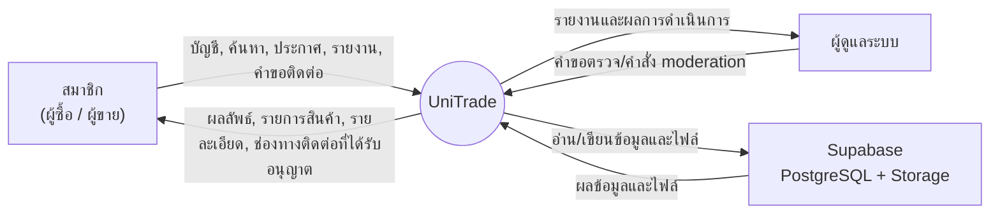
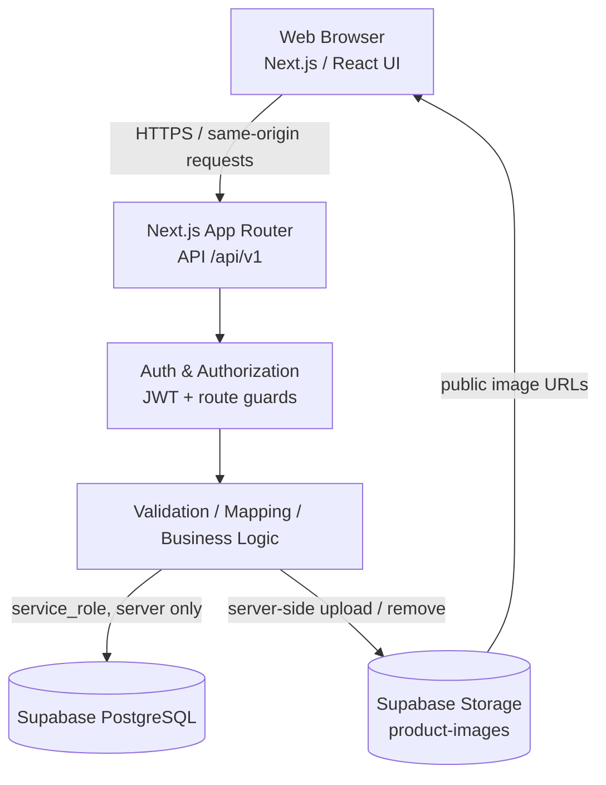
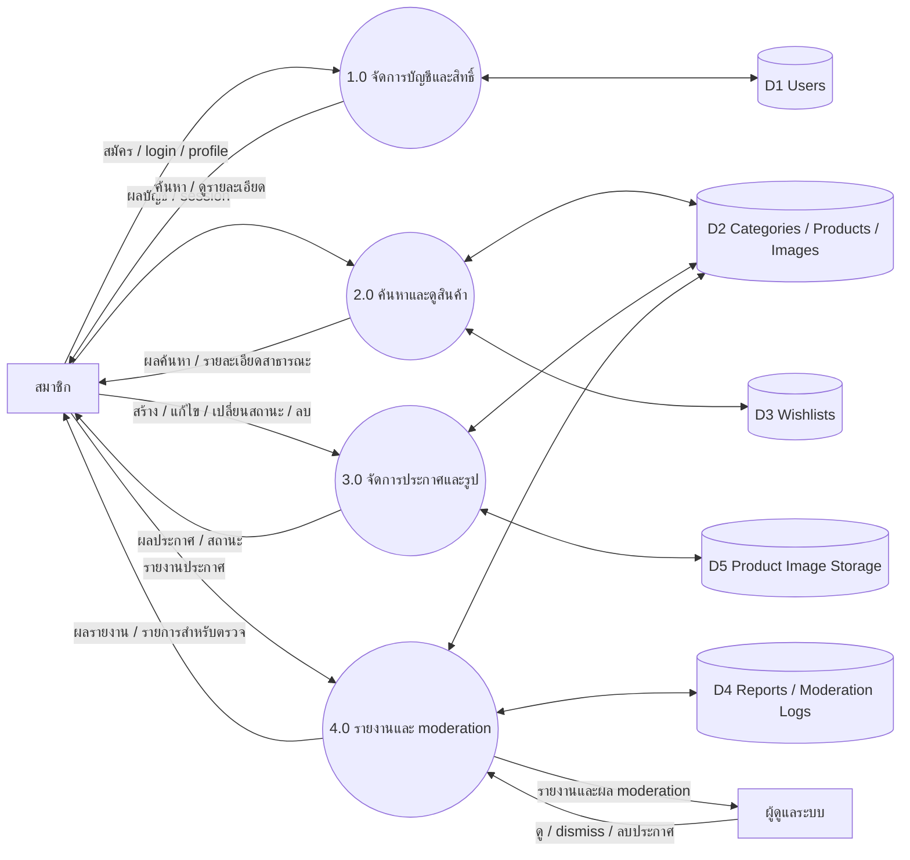
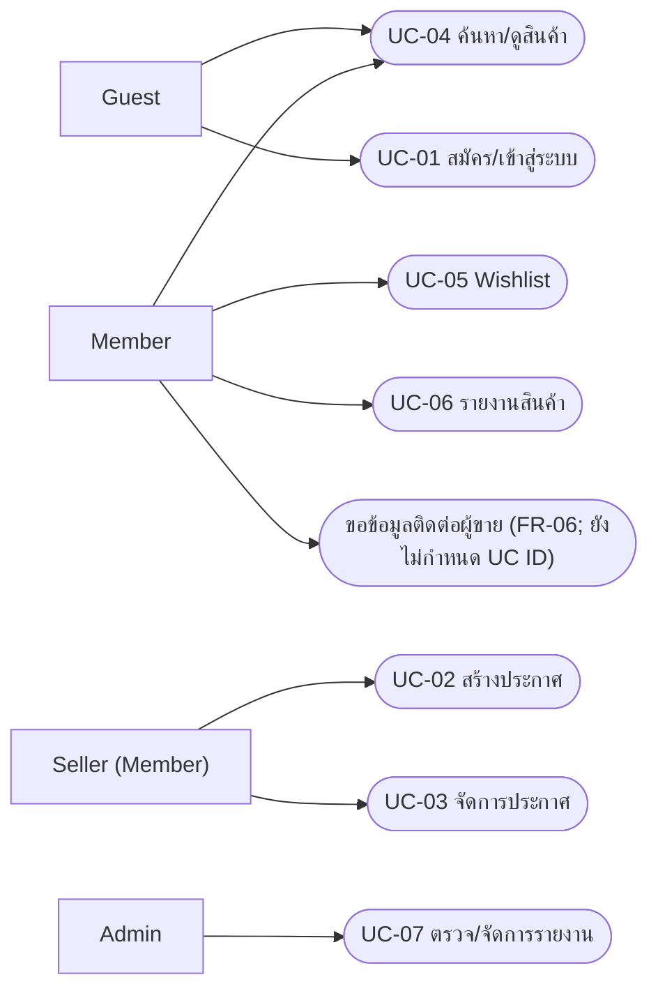
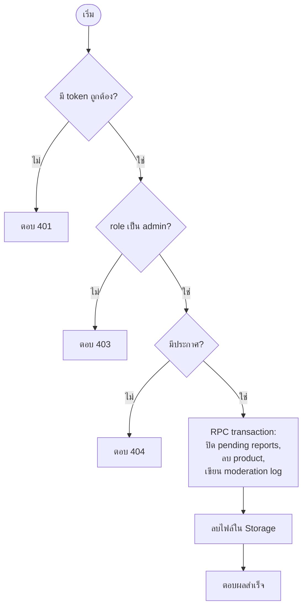
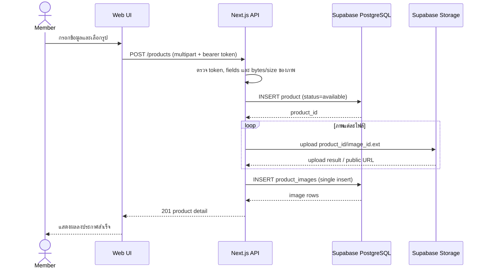
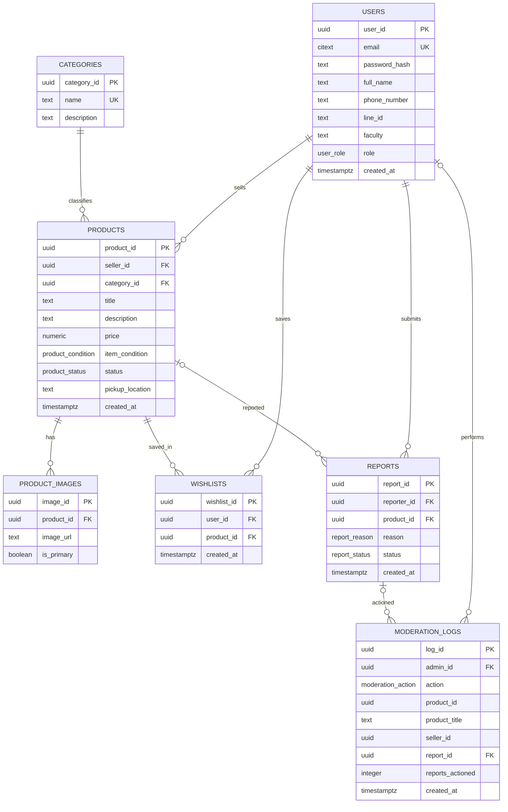
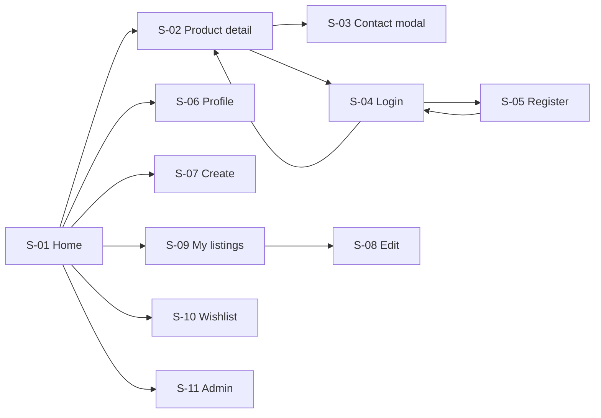

# รายงานโครงงานพัฒนาซอฟต์แวร์

## UniTrade — Campus Marketplace Platform

| รายการ | รายละเอียด |
|---|---|
| รายวิชา | 2301367 Software Engineering Methodology and development |
| ภาคการศึกษา / ปีการศึกษา | 2 / 2569 |
| อาจารย์ที่ปรึกษา | Pakawan Pugsee (ภควรรณ ปักษี) |
| คณะ / มหาวิทยาลัย | จุฬาลงกรณ์มหาวิทยาลัย |
| ทีม | VISIT CMU |
| วันที่จัดทำเอกสาร | 8 พฤศจิกายน 2569 |
| สถานะ | ฉบับร่างสำหรับตรวจทานและเติมข้อมูล |

## สารบัญ

1. [บทที่ 1 บทนำ](#บทที่-1-บทนำ-introduction)
2. [บทที่ 2 การเก็บรวบรวมข้อมูล](#บทที่-2-การเก็บรวบรวมข้อมูล)
3. [บทที่ 3 การวิเคราะห์ระบบ](#บทที่-3-การวิเคราะห์ระบบ-system-analysis)
4. [บทที่ 4 การออกแบบระบบ](#บทที่-4-การออกแบบระบบ-system-design)
5. [บทที่ 5 การพัฒนาและการทดสอบระบบ](#บทที่-5-การพัฒนาและการทดสอบระบบ-system-implementation-and-testing)
6. [บทที่ 6 การประเมินผลและสรุปผล](#บทที่-6-การประเมินผลและสรุปผล-evaluation-and-conclusion)
7. [ภาคผนวก](#ภาคผนวก-appendices)
8. [รายการข้อมูลที่ยังขาด](#รายการข้อมูลที่ยังขาดเพื่อปิดเล่ม)

---

# บทที่ 1 บทนำ (Introduction)

## 1.1 ความเป็นมา เหตุผลและแรงจูงใจ

นิสิตและบุคลากรจุฬาลงกรณ์มหาวิทยาลัยมีหนังสือเรียน เอกสารประกอบการเรียน เครื่องแต่งกาย อุปกรณ์อิเล็กทรอนิกส์ และของใช้ในหอพักที่ไม่ได้ใช้งานแล้ว ขณะเดียวกันสมาชิกในมหาวิทยาลัยยังมีความต้องการสิ่งของเหล่านี้ในราคาที่เหมาะสม ปัจจุบันการประกาศซื้อขายหรือส่งต่อมักเกิดขึ้นในกลุ่มสื่อสังคมออนไลน์

การใช้โพสต์ในสื่อสังคมออนไลน์ทำให้ค้นหาประกาศย้อนหลังและกรองสินค้าตามประเภทได้ยาก โพสต์ใหม่อาจดันโพสต์เก่าให้เลื่อนหาย และผู้ซื้ออาจไม่ทราบว่าสินค้ายังพร้อมขายหรือขายไปแล้ว นอกจากนี้ผู้ใช้ยังมีความกังวลเกี่ยวกับตัวตนและความน่าเชื่อถือของคู่ซื้อขาย และการส่งพัสดุในระยะใกล้อาจเพิ่มทั้งค่าใช้จ่ายและความเสี่ยงต่อสินค้า

ทีมจึงพัฒนา UniTrade เป็นเว็บตลาดกลางสำหรับนิสิตและบุคลากรจุฬาฯ โดยจำกัดการสมัครด้วยอีเมลโดเมนของมหาวิทยาลัย จัดหมวดหมู่และสถานะสินค้าให้ค้นหาได้ และสนับสนุนการนัดรับภายในพื้นที่มหาวิทยาลัย ระบบช่วยประสานข้อมูลเท่านั้น ไม่รับชำระเงินและไม่รับผิดชอบการส่งมอบสินค้า

**ข้อมูลอ้างอิงการเก็บความต้องการ:** ทีมสัมภาษณ์นิสิตระดับปริญญาตรีและบัณฑิตศึกษาจุฬาลงกรณ์มหาวิทยาลัย 12 คน และบุคลากรภายในมหาวิทยาลัย 4 คน ระหว่างวันที่ 9–11 กันยายน 2026 ณ ตึกมหาวชิรุณหิศ รายละเอียดวิธีการและข้อค้นพบสรุปไว้ในบทที่ 2

## 1.2 วัตถุประสงค์

1. พัฒนาเว็บแอปพลิเคชันสำหรับลงประกาศ ค้นหา และดูรายละเอียดสินค้ามือสองหรือสินค้าที่ให้ฟรีภายในชุมชนจุฬาฯ
2. จำกัดการสร้างบัญชีตามโดเมนอีเมลของนิสิตและบุคลากรจุฬาฯ
3. สนับสนุนการจัดการประกาศสินค้าและการแสดงสถานะ Available, Reserved และ Sold
4. สนับสนุนการนัดรับในมหาวิทยาลัยผ่านข้อมูลจุดนัดรับและช่องทางติดต่อที่ผู้ขายให้ไว้
5. จัดให้มีการรายงานประกาศและการตรวจสอบโดยผู้ดูแลระบบ
6. ฝึกกระบวนการเก็บความต้องการ วิเคราะห์ ออกแบบ พัฒนา และทดสอบซอฟต์แวร์เป็นทีม

## 1.3 ขอบเขตของงาน

### 1.3.1 ภายในขอบเขต

- เว็บแอปพลิเคชันสำหรับนิสิตและบุคลากรจุฬาฯ
- สมัครสมาชิก เข้าสู่ระบบ และจัดการข้อมูลโปรไฟล์
- ดูหมวดหมู่ จุดนัดรับ รายการสินค้า และรายละเอียดสินค้า
- ค้นหา กรอง เรียงลำดับ และแบ่งหน้ารายการสินค้า
- สร้าง แก้ไข เปลี่ยนสถานะ และลบประกาศของตนเอง พร้อมจัดเก็บรูปสินค้า
- รายงานประกาศ และเครื่องมือ API สำหรับผู้ดูแลตรวจสอบ/จัดการรายงาน
- ออกแบบ Wishlist และการเปิดเผยช่องทางติดต่อสำหรับผู้ใช้ที่ได้รับอนุญาต โดย API/หน้าจอบางส่วนยังรอพัฒนาและข้อสรุป
- ระบบหน้าเว็บและ API อยู่ในแอปพลิเคชัน Next.js เดียวกัน

### 1.3.2 นอกขอบเขต

- ระบบชำระเงินออนไลน์ บัตรเครดิต หรือ escrow
- การจัดส่งพัสดุ การคิดค่าส่ง หรือการติดตามพัสดุ
- ระบบแชตหรือข้อความสดภายในแอป
- การรับประกันสินค้า การรับรองตัวตนจากผู้ให้บริการยืนยันตัวตนภายนอก หรือการรับประกันการทำธุรกรรม
- แอปพลิเคชัน native สำหรับ iOS/Android

## 1.4 ประโยชน์ที่ได้รับ

- **นิสิตและบุคลากร:** ค้นหาสินค้าและของใช้ที่ต้องการได้เป็นระบบ ลดภาระค่าใช้จ่าย และส่งต่อของที่ไม่ได้ใช้
- **มหาวิทยาลัย:** สนับสนุนการใช้ทรัพยากรซ้ำและลดของเหลือทิ้งภายในชุมชน
- **ผู้พัฒนา:** ได้ฝึกการทำงานแบบแบ่งหน้าที่และใช้กระบวนการวิศวกรรมซอฟต์แวร์

## 1.5 คำศัพท์และคำย่อที่เกี่ยวข้อง

| คำศัพท์ | ความหมาย |
|---|---|
| CU | Chulalongkorn University — จุฬาลงกรณ์มหาวิทยาลัย |
| CRUD | Create, Read, Update, Delete |
| JWT | JSON Web Token ใช้ยืนยันคำขอที่ต้องล็อกอิน |
| RBAC | Role-Based Access Control การกำหนดสิทธิ์ตามบทบาท |
| Guest | ผู้เข้าชมที่ยังไม่ได้เข้าสู่ระบบ |
| Member | สมาชิกที่สมัครและเข้าสู่ระบบแล้ว |
| Admin | สมาชิกที่ได้รับบทบาทผู้ดูแลระบบ |
| Listing / Product | ประกาศสินค้าและข้อมูลประกอบ |
| On-campus pickup | การนัดส่งมอบสินค้าโดยตรงที่จุดนัดรับในมหาวิทยาลัย |
| SRS | Software Requirements Specification |

# บทที่ 2 การเก็บรวบรวมข้อมูล

## 2.1 กลุ่มเป้าหมาย

| กลุ่มเป้าหมาย | ลักษณะและความต้องการ |
|---|---|
| นิสิตจุฬาฯ | ต้องการซื้อหนังสือ ชีท อุปกรณ์การเรียน เครื่องแต่งกาย และของใช้ในหอพักในราคาประหยัด รวมถึงส่งต่อของที่ไม่ใช้แล้ว |
| บุคลากรและอาจารย์จุฬาฯ | ต้องการซื้อหรือส่งต่อหนังสือ อุปกรณ์สำนักงาน และของใช้ทั่วไป |
| ผู้ดูแลระบบ | ผู้ได้รับมอบหมายให้ตรวจสอบรายงานและจัดการประกาศที่ไม่เหมาะสม |

ผู้ซื้อและผู้ขายใช้บัญชีสมาชิกประเภทเดียวกัน สมาชิกอาจทำหน้าที่ใดหน้าที่หนึ่งหรือทั้งสองหน้าที่ได้

## 2.2 วิธีการและระเบียบวิธีเก็บข้อมูล (Data Collection Methodology)

- **กลุ่มตัวอย่างและขนาดกลุ่มเป้าหมาย:** นิสิตปัจจุบันระดับปริญญาตรีและบัณฑิตศึกษาจุฬาลงกรณ์มหาวิทยาลัย 12 คน และบุคลากรภายในมหาวิทยาลัย 4 คน รวม 16 คน
- **ช่วงเวลาที่เก็บข้อมูล:** 9–11 กันยายน 2026
- **สถานที่และช่องทาง:** สัมภาษณ์แบบเผชิญหน้า ณ ตึกมหาวชิรุณหิศ
- **การศึกษา/วิเคราะห์ระบบใกล้เคียง:** สังเกตพฤติกรรมและปัญหาในการซื้อขายจากกลุ่ม Facebook เช่น “ตลาดนัดนิสิตจุฬาฯ” และกลุ่มซื้อขายสินค้ามือสองทั่วไป
- **เกณฑ์คัดเลือกผู้ให้ข้อมูล (Inclusion Criteria):**
  - เป็นนิสิตหรือบุคลากรปัจจุบันของจุฬาลงกรณ์มหาวิทยาลัย
  - มีประสบการณ์ซื้อหรือขายสินค้ามือสองผ่านช่องทางออนไลน์ในช่วง 1 ปีที่ผ่านมา
- **ผู้สัมภาษณ์และผู้บันทึกข้อมูล:** ทีมพัฒนาโปรเจกต์ UniTrade โดยผู้รับผิดชอบหน้าที่ Project Manager และ QA/Doc

## 2.3 เครื่องมือและชุดคำถามในการสัมภาษณ์ (Interview Protocol)

เก็บข้อมูลด้วยการสัมภาษณ์เชิงลึก (In-depth Interview) โดยใช้หัวข้อคำถามหลักดังนี้:

1. **พฤติกรรมทั่วไป:** “ปกติมักจะซื้อหรือขายของมือสองผ่านช่องทางใด และประสบปัญหาอะไรบ่อยที่สุดในการใช้งาน?”
2. **ปัญหาความปลอดภัย:** “มีความกังวลมากน้อยเพียงใดเมื่อต้องซื้อขายของกับคนที่ไม่รู้จักในโลกออนไลน์ และต้องการให้มีระบบยืนยันตัวตนอย่างไร?”
3. **ความต้องการระบบ:** “หากมีแพลตฟอร์มกลางของจุฬาฯ โดยเฉพาะ ต้องการให้มีฟีเจอร์ใดเป็นอันดับแรก เช่น การกรองตามคณะ จุดนัดรับในมหาวิทยาลัย หรือระบบสถานะสินค้า?”

## 2.4 วิธีวิเคราะห์ข้อมูล (Data Analysis Method)

วิเคราะห์ข้อมูลด้วย **Thematic Analysis (การวิเคราะห์เชิงประเด็น)** โดยรวบรวมและถอดความข้อมูลจากการสัมภาษณ์ พร้อมจัดหมวดหมู่บันทึกจากการสังเกตกลุ่มซื้อขาย จากนั้นจัดกลุ่มประเด็นที่สอดคล้องกันเพื่อค้นหาปัญหาหลัก (Pain Points) และจัดลำดับความสำคัญของฟีเจอร์ (Feature Prioritization) ตามความต้องการของผู้ใช้

## 2.5 สรุปผลการศึกษาและข้อค้นพบ (Key Findings)

### 2.5.1 พฤติกรรมและปัญหาจากการซื้อขายผ่านสื่อสังคมออนไลน์ (User Pain Points)

- **ของที่ไม่ได้ใช้งาน:** นิสิตชั้นปี 3–4 มักมีหนังสือเรียน ชีทสรุป อุปกรณ์ไอที และเสื้อผ้าสภาพดีที่ไม่ได้ใช้แล้ว แต่เสียดายที่จะทิ้งและไม่สะดวกใจลงขายบนแพลตฟอร์มภายนอกเพราะขั้นตอนซับซ้อน
- **การจองแล้วไม่มาตามนัดและมิจฉาชีพ:** ผู้ให้ข้อมูลเคยพบผู้ซื้อจองแล้วหาย (Ghosting) หรือนัดแล้วไม่มาตามนัด รวมทั้งกังวลเรื่องบัญชีปลอมและการหลอกลวงให้โอนเงิน (Scam) เนื่องจากสื่อสังคมออนไลน์ทั่วไปตรวจสอบสถานะความเป็นนิสิตไม่ได้
- **ช่องทางติดต่อและโพสต์กระจัดกระจาย:** ประกาศขายปะปนกับเนื้อหาอื่น ทำให้ค้นหายาก ขณะที่การเปิดเผยเบอร์โทรศัพท์หรือ LINE ID ต่อสาธารณะทำให้กังวลเรื่องความเป็นส่วนตัว

### 2.5.2 ผลจากการศึกษา/วิเคราะห์ระบบใกล้เคียง (Competitor & Market Observation)

จากการสังเกตกลุ่ม Facebook “จุฬา มาร์เก็ตเพลส - ChulaMarketPlace.com” และกลุ่มซื้อขายสินค้ามือสองทั่วไป พบปัญหาหลักดังนี้:

- **โพสต์จมและกระจัดกระจาย:** โพสต์ขายสินค้าปะปนกับโพสต์เรื่องเรียนหรือเรื่องทั่วไป ทำให้ค้นหาสิ่งที่ต้องการยากและต้องใช้เวลาเลื่อนดู
- **ความเสี่ยงจากมิจฉาชีพ:** พบความเสี่ยงจากบัญชีปลอม (Fake Account) ที่โพสต์ขายสินค้าในราคาถูก แต่ไม่สามารถยืนยันตัวตนหรือความน่าเชื่อถือได้
- **ช่องทางติดต่อไม่เป็นระบบ:** ผู้ขายใช้ช่องทางหลากหลาย เช่น Direct Message, LINE หรือโทรศัพท์ และการเปิดเผยเบอร์โทรศัพท์หรือ LINE ID ต่อสาธารณะอาจทำให้เกิดปัญหาความเป็นส่วนตัว (Privacy Issue) หรือการถูกรบกวน

### 2.5.3 ประเภทสินค้าและจุดนัดรับที่ได้รับความนิยม (Popular Categories & Pickup Locations)

**ประเภทสินค้าที่ต้องการซื้อขายสูงสุด**

1. หนังสือเรียน ชีทสรุป และเอกสารประกอบการเรียน
2. อุปกรณ์อิเล็กทรอนิกส์และแกดเจ็ตเพื่อการศึกษา เช่น เครื่องคิดเลขวิทยาศาสตร์
3. เครื่องแต่งกายและชุดนิสิต

**จุดนัดรับยอดนิยมภายในมหาวิทยาลัย**

1. บริเวณอาคารคณะที่ผู้ให้ข้อมูลศึกษา/ทำงาน
2. ศาลาพระเกี้ยว ซึ่งเป็นศูนย์กลางที่เดินทางสะดวก
3. สามย่านมิตรทาวน์หรืออาคารจามจุรีสแควร์

### 2.5.4 ความต้องการด้านความปลอดภัยและฟีเจอร์ของระบบ (System Requirements & Trust)

- **การยืนยันตัวตน:** ผู้ให้ข้อมูลเห็นว่าความมั่นใจในการทำธุรกรรมจะเพิ่มขึ้น หากระบบกำหนดให้ใช้อีเมลสถาบัน (`@student.chula.ac.th, @chula.ac.th`) ในการสมัคร
- **ความเป็นส่วนตัวในการติดต่อ:** ผู้ให้ข้อมูลต้องการให้ซ่อนข้อมูลติดต่อส่วนตัว เช่น เบอร์โทรศัพท์และ LINE ID และเปิดเผยข้อมูลเมื่อผู้ซื้อเข้าสู่ระบบและกดปุ่มขอติดต่อเจ้าของประกาศเท่านั้น

### 2.5.5 ข้อมูลและฟังก์ชันที่นำไปใช้ในการวิเคราะห์ระบบ

| ข้อมูล | ตัวอย่างคุณลักษณะ |
|---|---|
| ผู้ใช้ | อีเมล CU, password hash, ชื่อ, คณะ, เบอร์โทร, LINE ID, role |
| หมวดหมู่ | รหัสหมวดหมู่, ชื่อ, คำอธิบาย |
| สินค้า | ผู้ขาย, หมวดหมู่, ชื่อ, รายละเอียด, ราคา, สภาพ, สถานะ, จุดนัดรับ, วันสร้าง |
| รูปสินค้า | สินค้า, URL รูป, ตัวบ่งชี้รูปหลัก |
| Wishlist | สมาชิก, สินค้าที่บันทึก, วันสร้างรายการ |
| รายงาน | ผู้รายงาน, สินค้า, เหตุผล, สถานะ, วันสร้าง |
| บันทึกผู้ดูแล | ผู้ดูแล, การกระทำ, สินค้า/รายงานที่เกี่ยวข้อง, วันดำเนินการ |

ข้อค้นพบข้างต้นนำไปสู่ความต้องการหลัก ได้แก่ การสมัครด้วยอีเมลของชุมชนมหาวิทยาลัย การค้นหาและกรองสินค้า การแสดงราคา สภาพ สถานะ รูป และจุดนัดรับ การจัดการประกาศและสถานะ การบันทึกสินค้าที่สนใจ การรายงานประกาศ และการควบคุมการเปิดเผยข้อมูลติดต่อ

ฟังก์ชันหลักที่เกี่ยวข้องประกอบด้วย CU Authentication และ Profile, Product Catalog, Search, Filter และ Pagination, Listing CRUD และ Image Upload, Product Status Management, Wishlist, Seller Contact, Report และ Admin Moderation รวมถึง Responsive Web UI ทั้งนี้รายละเอียดสถานะการพัฒนาของแต่ละฟังก์ชันอธิบายในบทที่ 5

# บทที่ 3 การวิเคราะห์ระบบ (System Analysis)

## 3.1 ภาพรวมของระบบ (System Overview)

UniTrade เป็นเว็บแอปพลิเคชันตลาดกลางสำหรับนิสิตและบุคลากรจุฬาฯ ผู้ใช้ทั่วไปสามารถดูและค้นหาสินค้าได้ สมาชิกที่เข้าสู่ระบบสามารถจัดการข้อมูลส่วนตัวและรายการที่มีสิทธิ์ ผู้ดูแลระบบจัดการรายงานตามบทบาท ระบบเว็บเรียก API ในแอป Next.js และ API ฝั่งเซิร์ฟเวอร์เชื่อมต่อ Supabase PostgreSQL และ Storage

ภาพบริบทและขอบเขตระบบฉบับเต็มอยู่ใน [CONTEXT-DIAGRAM.md](CONTEXT-DIAGRAM.md) แผนภาพด้านล่างย่อขอบเขตหลัก:

## 3.2 User Stories และเกณฑ์การตรวจรับงาน

### US-01 — สมัครสมาชิกและเข้าสู่ระบบด้วยอีเมลมหาวิทยาลัย

**User story:** As a นักศึกษา/บุคลากร, I want to สมัครสมาชิกและเข้าสู่ระบบด้วยอีเมลมหาวิทยาลัย, so that ยืนยันตัวตนได้และมั่นใจในความปลอดภัยในการซื้อขาย  
**Priority:** Must Have

**Acceptance criteria**

1. ระบบอนุญาตให้ลงทะเบียนเฉพาะโดเมนอีเมลจุฬาฯ `@student.chula.ac.th` เท่านั้น
2. รหัสผ่านต้องมีความยาวอย่างน้อย 8 ตัวอักษร และต้องถูกเข้ารหัสด้วยฟังก์ชัน hashing (เช่น bcrypt) ก่อนบันทึกลงฐานข้อมูล
3. ข้อมูลบังคับ ได้แก่ ชื่อ-นามสกุล อีเมล รหัสผ่าน และช่องทางติดต่ออย่างน้อย 1 ช่องทาง (LINE ID หรือเบอร์โทรศัพท์)
4. เมื่อเข้าสู่ระบบสำเร็จ ระบบต้องออก Access Token/Session ให้ผู้ใช้เพื่อเข้าถึงฟังก์ชันที่จำกัดสิทธิ์

### US-02 — ลงประกาศขายหรือส่งต่อสิ่งของ

**User story:** As a ผู้ขาย, I want to ลงประกาศขายหรือส่งต่อสิ่งของพร้อมรูปภาพและรายละเอียด, so that นิสิตคนอื่นสามารถเห็นและติดต่อขอซื้อต่อได้  
**Priority:** Must Have

**Acceptance criteria**

1. ฟอร์มลงประกาศมีข้อมูลบังคับ: ชื่อสินค้า หมวดหมู่ (หนังสือ/อุปกรณ์/ของใช้) สภาพสินค้า ราคา (หรือ 0 บาทกรณีส่งต่อฟรี) และสถานที่นัดรับในมหาวิทยาลัย
2. อัปโหลดรูปได้ 1–5 รูป รูปละไม่เกิน 2 MB รองรับ `.jpg`, `.jpeg`, `.png`
3. ระบบแสดงตัวอย่างรูปภาพ (Image Preview) ก่อนบันทึก
4. เมื่อสร้างสำเร็จ ข้อมูลต้องถูกบันทึกลงฐานข้อมูลและกำหนดสถานะเริ่มต้นเป็น Available โดยอัตโนมัติ

### US-03 — จัดการประกาศของตนเอง

**User story:** As a ผู้ขาย, I want to แก้ไข ลบ หรือเปลี่ยนสถานะสินค้าของตนเอง, so that ข้อมูลรายการสินค้าเป็นปัจจุบันและไม่สร้างความสับสนให้ผู้ซื้อ  
**Priority:** Must Have

**Acceptance criteria**

1. ปุ่มแก้ไขและลบแสดงและใช้งานได้เฉพาะเจ้าของโพสต์
2. ผู้ขายเปลี่ยนสถานะได้ 3 ระดับ: Available (พร้อมขาย), Reserved (ติดจอง), Sold (ขายแล้ว)
3. สินค้าที่เป็น Sold แสดงป้ายกำกับชัดเจนบนการ์ด และปุ่มติดต่อผู้ขายถูกปิดการทำงาน (Disabled)
4. ก่อนลบสินค้า ต้องมีกล่องข้อความยืนยัน (Confirmation Modal) เสมอ

### US-04 — ค้นหาและคัดกรองสินค้า

**User story:** As a ผู้ซื้อ, I want to ค้นหาด้วยคำสำคัญและคัดกรองสินค้าตามหมวดหมู่, so that หาสิ่งของที่ต้องการได้สะดวกรวดเร็วโดยไม่ต้องเลื่อนหาทั้งหมด  
**Priority:** Must Have

**Acceptance criteria**

1. ค้นหาจากชื่อและคำอธิบายแบบไม่แบ่งแยกตัวพิมพ์เล็ก-ใหญ่ (Case-Insensitive)
2. ใช้ตัวกรองร่วมกันได้ (Multiple Filters): หมวดหมู่ ช่วงราคา (Min-Max) และสถานะสินค้า
3. เรียงผลลัพธ์ได้ตามวันที่โพสต์ล่าสุด ราคาต่ำไปสูง และราคาสูงไปต่ำ
4. เมื่อไม่พบข้อมูล แสดงข้อความ “ไม่พบรายการสินค้าที่คุณต้องการ” และไม่แสดงข้อผิดพลาด

### US-05 — Wishlist และช่องทางติดต่อผู้ขาย

**User story:** As a ผู้ซื้อ, I want to บันทึกสินค้าที่สนใจไว้ในรายการโปรดและเข้าถึงช่องทางติดต่อผู้ขาย, so that กลับมาดูสินค้าภายหลังได้และติดต่อเพื่อนัดรับของได้ทันที  
**Priority:** Should Have

**Acceptance criteria**

1. ผู้ใช้ที่ล็อกอินกดไอคอนหัวใจเพื่อเพิ่ม/ลบสินค้าใน Wishlist ได้แบบ Real-time/Optimistic UI
2. หน้า Wishlist แสดงสินค้าที่บันทึกทั้งหมด และลบรายการจากหน้านี้ได้
3. หน้ารายละเอียดมีปุ่มเปิด LINE (`line.me/ti/p/~line_id`) หรือโทรออก (`tel:`) ตามข้อมูลผู้ขาย

### US-06 — รายงานโพสต์และตรวจสอบโดย Admin

**User story:** As a ผู้ใช้งานทั่วไปและ Admin, I want to รายงานโพสต์ที่ไม่เหมาะสมและให้ Admin ตรวจสอบ/ลบโพสต์ได้, so that แพลตฟอร์มมีความปลอดภัยและปราศจากการหลอกลวง  
**Priority:** Should Have

**Acceptance criteria**

1. ผู้ใช้กด “รายงานโพสต์” พร้อมเลือกเหตุผลจากรายการที่กำหนด เช่น สินค้าผิดกฎหมาย หลอกลวง หรือสแปม
2. หน้า Admin Dashboard เข้าถึงได้เฉพาะ Admin; ผู้ใช้ทั่วไปถูกปฏิเสธด้วย `403 Forbidden`
3. Admin ดูตารางโพสต์ที่ถูกรายงาน จำนวนครั้งที่ถูกรายงาน และรายละเอียดโพสต์ต้นทางได้
4. Admin สั่งลบโพสต์ที่ไม่เหมาะสมออกจากระบบได้

## 3.3 ความต้องการด้านหน้าที่ (Functional Requirements)

| รหัส | ฟังก์ชัน | Input | Process / เงื่อนไขสำคัญ | Output |
|---|---|---|---|---|
| FR-01 | สมัครสมาชิกผู้ใช้ CU | อีเมล, รหัสผ่าน, ชื่อ, คณะ, เบอร์หรือ LINE | ตรวจโดเมน CU และรูปแบบข้อมูล, hash รหัสผ่าน, ป้องกันอีเมลซ้ำ | ผลสมัครและข้อมูลผู้ใช้ที่ไม่รวม password hash |
| FR-02 | Authentication และ Authorization | อีเมล/รหัสผ่าน หรือ bearer token | ตรวจบัญชีและ bcrypt hash, ออก HS256 JWT อายุ 24 ชม.; ตรวจสิทธิ์ทุก protected operation | token และผลการตรวจสิทธิ์ |
| FR-03 | สร้างประกาศสินค้า | ฟิลด์สินค้าและ JPEG/PNG 1–5 รูป | ตรวจข้อมูล/ขนาด/bytes, ตั้งรูปแรกเป็น primary, สร้างสินค้าและ upload | รายละเอียดประกาศและผลสำเร็จ |
| FR-04 | จัดการประกาศ | product ID, body หรือสถานะใหม่ | ตรวจมีสินค้าและเจ้าของก่อน validate; อนุญาตแก้ไข/เปลี่ยนสถานะ/ลบตามสิทธิ์ | รายละเอียด/สถานะ/ผลลบ |
| FR-05 | ค้นหาและกรองสินค้า | keyword, category, price, free_only, status, location, condition, sort | validate query, keyword case-insensitive, stable pagination; ครอบคลุมการดูรายการและรายละเอียดสาธารณะ | รายการและ pagination หรือ empty list / product detail |
| FR-06 | ดูข้อมูลติดต่อผู้ขาย | product ID และ token | ต้องล็อกอิน; ห้ามส่งข้อมูลติดต่อตาม public product API | ช่องทางติดต่อและ pickup; UI มี แต่ API ยังไม่ทำ |
| FR-07 | Wishlist | สมาชิกและ product ID | ต้องล็อกอินและจำกัดเจ้าของข้อมูล | รายการที่บันทึกและสถานะ wishlisted; API contract ยังไม่กำหนด |
| FR-08 | Report & Moderation | report reason/product ID หรือคำสั่งจาก Admin | ต้องล็อกอิน, ห้ามรายงานตนเอง/รายงานซ้ำ; admin ตรวจ role และบันทึก moderation log | ผลการรายงาน, รายการรายงาน และผลการดำเนินการ |
| FR-09 | จัดการโปรไฟล์สมาชิก | bearer token และข้อมูลโปรไฟล์ | ให้สมาชิกอ่าน/แก้เฉพาะโปรไฟล์ตนเอง; ห้ามแก้อีเมล/role และต้องเหลือ contact อย่างน้อยหนึ่งช่องทาง | ข้อมูลโปรไฟล์ที่อนุญาต; API มี แต่หน้า UI ยังไม่ครบ |
| FR-10 | ส่วนติดต่อผู้ใช้และสถานะการทำงาน | การกระทำของผู้ใช้และข้อมูลจาก API | รองรับการนำทาง การแสดงผล responsive และสถานะ loading/empty/error/success | หน้าจอและข้อความภาษาไทยตาม flow ที่ทำแล้ว |

### ข้อกำหนดตรวจสอบข้อมูลหลัก

- อีเมลต้องลงท้ายด้วย `@student.chula.ac.th` หรือ `@chula.ac.th`
- รหัสผ่านอย่างน้อย 8 ตัว มีตัวอักษรและตัวเลข และไม่เกิน 72 UTF-8 bytes สำหรับ bcrypt
- ต้องระบุเบอร์โทรหรือ LINE ID อย่างน้อยหนึ่งช่องทาง
- ชื่อ 2–255 ตัวอักษร; ชื่อสินค้า 3–255; รายละเอียดไม่เกิน 2,000
- ราคา 0–999,999.99 และมีทศนิยมไม่เกิน 2 ตำแหน่ง
- รูป 1–5 รูป, JPEG/PNG จากการตรวจ bytes, ≤2 MiB ต่อรูป และ ≤4 MiB รวม
- สถานะสินค้า: `available`, `reserved`, `sold`

## 3.4 ความต้องการที่ไม่ใช่ด้านหน้าที่ (Non-functional Requirements)

| รหัส | ข้อกำหนด | วิธีตรวจสอบ / สถานะ |
|---|---|---|
| NFR-01 | Route ที่ต้องป้องกันต้องตรวจ authentication/authorization ฝั่ง server | ตรวจ code และ negative API tests |
| NFR-02 | Admin role ต้องตรวจจาก server-controlled data | ตรวจ `requireAdmin` และทดสอบบัญชี member |
| NFR-03 | รหัสผ่านเก็บเป็น bcrypt hash เท่านั้น | ตรวจ implementation/schema |
| NFR-04 | JWT ใช้ HS256 อายุ 24 ชั่วโมง และ secret อยู่ฝั่ง server | unit test auth |
| NFR-05 | Production ใช้ HTTPS | ต้องตรวจ deployment จริง; deployment status ยังไม่ยืนยัน |
| NFR-06 | ห้ามเปิดเผย service key/JWT secret | ตรวจ config, source control และ bundle ก่อน release |
| NFR-07 | Public response ต้องไม่มีอีเมล/เบอร์/LINE/password hash | unit tests ของ product mappers และ API tests |
| NFR-08 | ห้ามคืนข้อความ Supabase ดิบแก่ client | ตรวจ route error handling |
| NFR-09 | หน้าแรกโหลดไม่เกิน 3 วินาที | **เป้าหมายต้นฉบับ; วิธีวัดและผล [เว้นไว้รอข้อมูล]** |
| NFR-10 | Product list/search API ≤500 ms ที่ 50 concurrent users | **เป้าหมายต้นฉบับ; test setup/result [เว้นไว้รอข้อมูล]** |
| NFR-11 | Availability ≥95% ในช่วงทดสอบ/นำเสนอ | **เป้าหมายต้นฉบับ; ช่วงวัด/ผล [เว้นไว้รอข้อมูล]** |
| NFR-12 | Responsive อย่างน้อย 375px และ desktop 1024px ขึ้นไป | ทดสอบ UI บน browser/device matrix; รายงานผลรอเติม |
| NFR-13 | รองรับ current stable Chrome และ Safari | เวอร์ชันและผลทดสอบ [เว้นไว้รอข้อมูล] |
| NFR-14 | รองรับ Node.js 22+ | package manifest กำหนด `>=22` |
| NFR-15 | Frontend และ API deploy ใน Next.js application เดียว | ตรวจ architecture/build |

## 3.5 ความต้องการด้านส่วนต่อประสานภายนอก (External Interface Requirements)

### 3.5.1 User Interface

- ภาษาแสดงผลหลักเป็นภาษาไทย
- Home แสดงหมวดหมู่ การ์ดสินค้า Search/Filter, Sort และ Pagination
- Product detail แสดงข้อมูลประกาศโดยไม่ฝังข้อมูลติดต่อผู้ขายใน public response
- ปุ่มติดต่อและเมนูสมาชิกต้องเปลี่ยนตามสถานะ guest/authenticated
- API errors แสดงเป็นข้อความที่เหมาะกับผู้ใช้และเชื่อมกับฟิลด์ที่ผิดเมื่อมี `field`

### 3.5.2 Software/Communication Interface

| Interface | รายละเอียด |
|---|---|
| Web/API | Next.js routes ใต้ `/api/v1`; JSON โดยทั่วไป, multipart สำหรับสร้างสินค้า |
| Database | Supabase PostgreSQL ผ่าน server-side service role |
| Image storage | Supabase Storage bucket `product-images`; server เป็นผู้ upload/remove |
| Auth | Bearer JWT อายุ 24 ชั่วโมง |
| Seller contact | LINE/โทรศัพท์ภายนอก; Contact API ยังรอการกำหนด owner/contract |

## 3.6 สภาพแวดล้อมการทำงานของระบบ (System Environment)

| ส่วนประกอบ | สภาพแวดล้อม |
|---|---|
| Runtime | Node.js 22+ |
| Framework/UI | Next.js 15 App Router, React 19, JavaScript ESM |
| Database | Supabase PostgreSQL |
| Object storage | Supabase Storage |
| Hosting target | Vercel |
| Client | Chrome/Safari รุ่นปัจจุบันบน desktop/mobile; ต้องยืนยันรุ่นทดสอบ |
| Source control | Git/GitHub |
| Development editor | Visual Studio Code ตาม environment เอกสารทีม |

# บทที่ 4 การออกแบบระบบ (System Design)

## 4.1 ภาพรวมการออกแบบระบบ (System Design Overview)

ออกแบบเป็นเว็บแอปพลิเคชันเดียวที่มีหน้าเว็บและ API อยู่ใน Next.js repository เดียวกัน เพื่อลดความซับซ้อนในการ deploy และไม่ต้องตั้ง CORS ระหว่าง frontend กับ API ชั้นหน้าเว็บเรียก API ผ่าน shared request helper ส่วน API ทำหน้าที่ตรวจ token, ตรวจสิทธิ์, ตรวจข้อมูล และเรียก Supabase ด้วย secret ที่อยู่ฝั่ง server เท่านั้น

การออกแบบรักษาความเป็นส่วนตัวโดยแยก product detail สาธารณะออกจากข้อมูลติดต่อผู้ขาย และคงความถูกต้องของการสร้างประกาศด้วยการตรวจไฟล์ก่อนแตะฐานข้อมูล พร้อม cleanup เมื่อการอัปโหลดหลายขั้นตอนไม่สำเร็จ

## 4.2 การออกแบบสถาปัตยกรรมระบบ (System Architecture Design)

**เหตุผลที่เลือกใช้**

1. Next.js รวมหน้าเว็บและ route handlers ไว้ในโปรเจกต์เดียว ทำให้ deploy ได้พร้อมกัน
2. Supabase ให้บริการ PostgreSQL และ object storage ที่รองรับข้อมูลสัมพันธ์และรูปสินค้า
3. การติดต่อฐานข้อมูลผ่าน server ช่วยไม่ให้ credential ระดับ service role ไปอยู่ใน browser
4. Shared auth/validation/mapping helpers ลดความแตกต่างระหว่าง endpoint

**ข้อจำกัด:** service role ข้าม RLS ได้ จึงต้องตรวจ authorization ในทุก route ที่เข้าถึงข้อมูลส่วนตัวหรือเขียนข้อมูล; ความปลอดภัยของระบบขึ้นกับการครอบ route และการตรวจ owner/admin อย่างถูกต้อง

## 4.3 การออกแบบกระบวนการทำงานของระบบ (Process Design)

### 4.3.1 Context Diagram และ DFD Level 0

แผนภาพ context ฉบับเต็มอยู่ที่ [CONTEXT-DIAGRAM.md](CONTEXT-DIAGRAM.md) DFD Level 0 ด้านล่างแสดง process หลักและ data stores:

**Data stores:** D1 ผู้ใช้, D2 หมวดหมู่/สินค้า/รูป metadata, D3 Wishlist, D4 รายงาน/บันทึก moderation, D5 ไฟล์รูปสินค้า

### 4.3.2 กระบวนการหลัก

| Process | ขั้นตอนหลัก | เงื่อนไข/ผลลัพธ์ |
|---|---|---|
| สมัคร/เข้าสู่ระบบ | รับข้อมูล → validate → ตรวจ/สร้างบัญชี → ตรวจ password hash → ออก JWT | โดเมนอีเมล CU; JWT 24 ชม.; ไม่ส่ง hash กลับ |
| ค้นหาสินค้า | รับ query → validate → ประกอบ filters → query พร้อม count/order/range → map response | ค่าเริ่มต้น status=available; page size สูงสุด 50; no result เป็น 200 + `data: []` |
| สร้างประกาศ | parse multipart → validate fields/images → insert product → upload files → insert image rows → map detail | ถ้าขั้น upload/insert image ล้มเหลว พยายาม cleanup files และ product |
| จัดการประกาศ | หาและตรวจเจ้าของ → validate body → update/delete | non-owner ได้ 403; image edit ไม่รองรับ |
| รายงานสินค้า | ตรวจ token → ตรวจสินค้า → กัน self-report/duplicate → insert pending report | ใช้เหตุผลจาก enum ที่กำหนด |
| Admin moderation | ตรวจ token/role → ทำรายการ/ยกเลิกรายงาน/ลบสินค้าแบบ atomic → บันทึก log → cleanup รูป | เฉพาะ admin; ลบ report/product ใน transaction ตาม migration function |

### 4.3.3 Use Case Diagram

### 4.3.4 Use Case Description: UC-01 สมัครสมาชิกและเข้าสู่ระบบ

| หัวข้อ | รายละเอียด |
|---|---|
| ผู้กระทำหลัก | Guest (สมัครสมาชิก); ผู้ใช้ที่มีบัญชี (เข้าสู่ระบบ) |
| เงื่อนไขก่อนเริ่ม | สมัครสมาชิก: ยังไม่มีบัญชีด้วยอีเมลนั้นและมีอีเมล/ข้อมูลที่ระบบรองรับ; เข้าสู่ระบบ: มีบัญชีที่ลงทะเบียนแล้ว |
| ข้อมูลนำเข้า | สมัคร: อีเมล รหัสผ่าน ชื่อ คณะ และช่องทางติดต่ออย่างน้อยหนึ่งช่องทาง; เข้าสู่ระบบ: อีเมลและรหัสผ่าน |
| ขั้นตอนปกติ | 1) ผู้ใช้เลือกสมัครสมาชิกหรือเข้าสู่ระบบ 2) กรอกและส่งข้อมูล 3) ระบบตรวจสอบข้อมูลและโดเมนอีเมล 4) กรณีสมัคร ระบบบันทึกบัญชีโดยเก็บรหัสผ่านเป็น bcrypt hash; กรณีเข้าสู่ระบบ ระบบตรวจสอบรหัสผ่าน 5) เมื่อเข้าสู่ระบบสำเร็จ ระบบออก JWT และส่งข้อมูลผู้ใช้ที่เปิดเผยได้กลับ |
| ทางเลือก/ข้อผิดพลาด | ข้อมูลสมัครไม่ถูกต้องหรืออีเมลไม่รองรับ → แจ้งข้อผิดพลาดตาม API; อีเมลซ้ำ → ปฏิเสธการสมัคร; ข้อมูลเข้าสู่ระบบไม่ถูกต้อง → ปฏิเสธการเข้าสู่ระบบ |
| เงื่อนไขหลังจบ | สมัครสำเร็จมีบัญชีสมาชิก; เข้าสู่ระบบสำเร็จมี session token อายุ 24 ชั่วโมง โดยไม่ส่ง password hash หรือ signing secret ให้ client |
| สถานะการส่งมอบ | Auth API และหน้าสมัครมี; หน้า Login ยังเป็น placeholder จึงยังไม่ถือว่าจบ flow ฝั่ง UI |

### 4.3.5 Use Case Description: UC-02 สร้างประกาศสินค้า

| หัวข้อ | รายละเอียด |
|---|---|
| ผู้กระทำหลัก | Member |
| เงื่อนไขก่อนเริ่ม | ผู้ใช้เข้าสู่ระบบและมี JWT ที่ยังใช้ได้ |
| ข้อมูลนำเข้า | title, description (optional), category, condition, price, pickup location, images 1–5 |
| ขั้นตอนปกติ | 1) ผู้ใช้กรอกข้อมูลและเลือกภาพ 2) ระบบ validate fields/images ก่อนเขียน DB 3) สร้าง product สถานะ available 4) อัปโหลดภาพ 5) บันทึก image metadata และกำหนดภาพแรกเป็น primary 6) ส่งรายละเอียดประกาศกลับ |
| ทางเลือก/ข้อผิดพลาด | payload ผิด → 400; ข้อมูลผิด → 422; ภาพใหญ่ → 413; ไฟล์ไม่ใช่ JPEG/PNG → 422; storage/database error → cleanup ที่เกี่ยวข้องและตอบ server error |
| เงื่อนไขหลังจบ | เมื่อสำเร็จมี product และ image metadata/files ที่เกี่ยวข้อง; เมื่อขั้นตอนภาพล้มเหลวพยายามลบข้อมูลที่สร้างไว้ |
| สถานะการส่งมอบ | API และหน้าฟอร์มลงประกาศมี; การยอมรับครบถ้วนรอผล system test |

### 4.3.6 Use Case Description: UC-03 จัดการประกาศของตนเอง

| หัวข้อ | รายละเอียด |
|---|---|
| ผู้กระทำหลัก | Seller (Member) |
| เงื่อนไขก่อนเริ่ม | ผู้ใช้เข้าสู่ระบบและเป็นเจ้าของประกาศ |
| ข้อมูลนำเข้า | รหัสประกาศ และการกระทำที่เลือก: แก้ไขข้อมูล เปลี่ยนสถานะ หรือ ลบประกาศ |
| ขั้นตอนปกติ | 1) ผู้ใช้เปิดรายการประกาศของตน 2) เลือกประกาศและการกระทำ 3) ระบบตรวจรหัสประกาศและความเป็นเจ้าของก่อนตรวจข้อมูลคำขอ 4) กรณีแก้ไข ระบบตรวจฟิลด์ที่แก้ได้; กรณีเปลี่ยนสถานะ ตรวจค่า available/reserved/sold; กรณีลบ ลบข้อมูลประกาศแล้วจึงพยายามลบไฟล์รูป 5) ระบบส่งผลการทำงานกลับ |
| ทางเลือก/ข้อผิดพลาด | ไม่พบหรือรหัสไม่ถูกต้อง → 404; ไม่ใช่เจ้าของ → 403; ข้อมูลแก้ไขหรือสถานะไม่ถูกต้อง → 422; หากลบไฟล์ไม่สำเร็จหลังลบข้อมูลแล้ว ให้บันทึกข้อผิดพลาดโดยไม่รายงานว่าการลบฐานข้อมูลล้มเหลว |
| เงื่อนไขหลังจบ | ประกาศถูกแก้ไข เปลี่ยนสถานะ หรือลบตามการกระทำ; การแก้ไขไม่เปลี่ยนผู้ขายหรือสถานะ และไม่รองรับแก้รูปผ่านการแก้ไขประกาศ |
| สถานะการส่งมอบ | API และหน้า My Listings/จัดการสถานะมี; การยอมรับครบถ้วนรอผล system test |

### 4.3.7 Use Case Description: UC-04 ค้นหาและดูสินค้า

| หัวข้อ | รายละเอียด |
|---|---|
| ผู้กระทำหลัก | Guest หรือ Member |
| เงื่อนไขก่อนเริ่ม | ระบบและรายการสินค้าพร้อมให้บริการ; การค้นหาสาธารณะไม่ต้องเข้าสู่ระบบ |
| ข้อมูลนำเข้า | คำค้น หมวดหมู่ ช่วงราคา ตัวเลือกสินค้าฟรี สถานะ จุดนัดรับ สภาพสินค้า การเรียงลำดับ และเลขหน้า |
| ขั้นตอนปกติ | 1) ผู้ใช้เปิดหน้ารายการสินค้า 2) ระบุคำค้นหาหรือตัวกรอง 3) ระบบตรวจ query และค้นหา/จัดเรียง/แบ่งหน้า 4) ระบบแสดงการ์ดสินค้าและข้อมูล pagination 5) ผู้ใช้เลือกรายการเพื่อดูรายละเอียดสินค้า |
| ทางเลือก/ข้อผิดพลาด | ไม่มีผลลัพธ์ → ตอบสำเร็จพร้อมรายการว่าง; query ไม่ถูกต้อง → validation error; รหัสสินค้าไม่ถูกต้องหรือไม่พบในหน้ารายละเอียด → HTTP 200 พร้อม `{ "data": [] }`; ข้อมูลสาธารณะต้องไม่เปิดเผยอีเมล เบอร์โทร หรือ LINE ID ผู้ขาย |
| เงื่อนไขหลังจบ | ผู้ใช้เห็นผลค้นหาและรายละเอียดที่เปิดเผยได้ โดยสินค้าทุกสถานะยังดูรายละเอียดได้ |
| สถานะการส่งมอบ | Product read/search API และหน้า Home/Search/Product Detail มี; การยอมรับครบถ้วนรอผล system test |

### 4.3.8 Use Case Description: UC-05 จัดการรายการโปรด (Wishlist)

| หัวข้อ | รายละเอียด |
|---|---|
| ผู้กระทำหลัก | Member |
| เงื่อนไขก่อนเริ่ม | ผู้ใช้เข้าสู่ระบบ |
| ข้อมูลนำเข้า | รหัสสินค้าเพื่อเพิ่ม/นำออก หรือคำขอดูรายการโปรดของบัญชีตนเอง |
| ขั้นตอนปกติ | 1) ผู้ใช้กดบันทึกสินค้าหรือเปิด Wishlist 2) ระบบตรวจ session และผูกข้อมูลกับผู้ใช้ปัจจุบัน 3) เมื่อ toggle สินค้า ระบบเพิ่มรายการหากยังไม่เคยบันทึก หรือเอาออกหากบันทึกอยู่แล้ว 4) เมื่อเปิด Wishlist ระบบส่งการ์ดสินค้าที่บันทึกไว้ 5) ผู้ใช้สามารถนำสินค้าออกจากรายการได้ |
| ทางเลือก/ข้อผิดพลาด | ไม่มี session → ปฏิเสธตามข้อกำหนด authentication; ไม่พบสินค้า → แจ้งไม่พบสินค้า; คำขอลบนำออกซ้ำให้ผลสำเร็จโดยไม่สร้างข้อผิดพลาด |
| เงื่อนไขหลังจบ | ผู้ใช้เห็นหรือเปลี่ยนแปลงได้เฉพาะ Wishlist ของตน; เมื่อลบสินค้ารายการ Wishlist ที่เกี่ยวข้องถูกลบตามความสัมพันธ์ฐานข้อมูล |
| สถานะการส่งมอบ | Wishlist API และหน้า Wishlist มี; ต้องตรวจพฤติกรรม toggle และการบันทึกประกาศของตนเองเทียบ API Specification ก่อนยอมรับ |

### 4.3.9 Use Case Description: UC-06 รายงานประกาศ

| หัวข้อ | รายละเอียด |
|---|---|
| ผู้กระทำหลัก | Member ที่ไม่ใช่เจ้าของประกาศ |
| เงื่อนไขก่อนเริ่ม | ผู้ใช้เข้าสู่ระบบและประกาศเป้าหมายมีอยู่ |
| ข้อมูลนำเข้า | รหัสประกาศและเหตุผลจากรายการที่ระบบกำหนด |
| ขั้นตอนปกติ | 1) ผู้ใช้เลือกแจ้งรายงานจากประกาศ 2) เลือกเหตุผลและส่งคำขอ 3) ระบบตรวจ session, ประกาศ, เหตุผล และเงื่อนไขห้ามรายงานประกาศตนเอง/รายงานซ้ำ 4) ระบบสร้างรายงานสถานะ pending 5) ระบบยืนยันการส่งรายงาน |
| ทางเลือก/ข้อผิดพลาด | ไม่มี session → 401; ไม่พบประกาศ → not found; รายงานประกาศตนเอง → ปฏิเสธ; เหตุผลไม่ถูกต้องหรือรายงานซ้ำ → แจ้งข้อผิดพลาดตาม API |
| เงื่อนไขหลังจบ | รายงานที่สำเร็จถูกบันทึกเพื่อให้ผู้ดูแลตรวจสอบ; ข้อมูลภายในหรือข้อผิดพลาดฐานข้อมูลไม่ถูกเปิดเผยแก่ผู้ใช้ |
| สถานะการส่งมอบ | Report API มี; การทดสอบ UI และ flow ครบวงจรรอ TASK-21 |

### 4.3.10 Use Case Description: UC-07 ตรวจสอบและจัดการรายงาน

| หัวข้อ | รายละเอียด |
|---|---|
| ผู้กระทำหลัก | Admin |
| เงื่อนไขก่อนเริ่ม | ผู้ดูแลเข้าสู่ระบบและระบบยืนยัน role จากข้อมูลฝั่ง server |
| ข้อมูลนำเข้า | ตัวกรองสถานะ/เลขหน้า; รหัสรายงานเพื่อ dismiss หรือรหัสประกาศเพื่อดำเนินการลบ |
| ขั้นตอนปกติ | 1) Admin เปิดรายการรายงาน 2) ระบบตรวจสิทธิ์และแสดงรายการที่ตรงกับตัวกรอง 3) Admin เลือกยกเลิกรายงานหรือสั่งลบประกาศ 4) กรณียกเลิก ระบบปรับสถานะและบันทึก moderation log; กรณีลบ ระบบดำเนินการที่เกี่ยวข้องใน transaction และบันทึก log 5) หลังฐานข้อมูลลบสำเร็จ ระบบพยายามลบไฟล์รูป 6) ระบบแสดงผลการดำเนินการ |
| ทางเลือก/ข้อผิดพลาด | ไม่มี/ผิด token → 401; ผู้ใช้ไม่ใช่ Admin → 403; ไม่พบเป้าหมาย → not found; ความผิดพลาดใน transaction → ไม่รายงานความสำเร็จและไม่ทำการลบไฟล์ก่อนฐานข้อมูลยืนยัน |
| เงื่อนไขหลังจบ | การกระทำของ Admin มี audit record; การลบประกาศคงข้อมูลรายงานตามกติกาฐานข้อมูล |
| สถานะการส่งมอบ | Report/Admin API และหน้า Admin มี; การทดสอบครบวงจรรอ TASK-21 |

### 4.3.11 Use Case สนับสนุน: ขอข้อมูลติดต่อผู้ขาย (FR-06)

Use case diagram แสดงการขอข้อมูลติดต่อผู้ขายเป็นกรณีใช้งาน แต่ชุด UC-01–UC-07 ที่ทีมกำหนดยังไม่ได้ระบุรหัสให้กรณีนี้ จึงยังไม่กำหนด UC ID เพิ่มในเอกสารฉบับนี้ ตามข้อกำหนด ผู้ใช้ต้องเข้าสู่ระบบก่อนจึงขอข้อมูลติดต่อได้ และข้อมูลติดต่อห้ามปรากฏในหน้ารายละเอียดสาธารณะ อย่างไรก็ตาม Contact API และสัญญา API ยังรอการกำหนด/อนุมัติ จึงยังระบุขั้นตอนตอบกลับและเงื่อนไขสถานะสินค้าเป็นข้อสรุปไม่ได้ ปุ่มและ modal ในหน้าเว็บยังไม่เทียบเท่ากับการส่งมอบ flow นี้ครบถ้วน

> **ขอบเขตเอกสาร:** รายละเอียด UC ข้างต้นเป็นฉบับสรุปที่จัดทำจาก SRS, API ที่มีใน repository และข้อมูลโครงการที่ระบุไว้ในเอกสาร ไม่ใช่ไฟล์ Use Case ต้นฉบับที่อนุมัติใน TASK-03

### 4.3.12 Activity Diagram: Admin ลบประกาศ

### 4.3.13 Sequence Diagram: สร้างประกาศ

## 4.4 การออกแบบข้อมูล (Data Design)

### 4.4.1 ER Diagram

## 4.5 การออกแบบฐานข้อมูล (Database Design)

ฐานข้อมูลเป็น Supabase PostgreSQL; ชนิด enum ใช้ค่าที่กำหนดใน migration `0001_init.sql`. FK delete behavior ระบุเฉพาะที่ตั้งไว้ใน migration.

| ตาราง | ฟิลด์ (ชนิดข้อมูล) | PK / FK / ข้อจำกัดสำคัญ |
|---|---|---|
| `users` | `user_id uuid`, `email citext`, `password_hash text`, `full_name text`, `phone_number text NULL`, `line_id text NULL`, `faculty text`, `role user_role`, `created_at timestamptz` | PK `user_id`; unique `email`; CHECK CU email, bcrypt hash, format/length และ phone hoặc LINE อย่างน้อยหนึ่ง |
| `categories` | `category_id uuid`, `name text`, `description text NULL` | PK `category_id`; unique `name` |
| `products` | `product_id uuid`, `seller_id uuid`, `category_id uuid`, `title text`, `description text NULL`, `price numeric(10,2)`, `item_condition product_condition`, `status product_status`, `pickup_location text`, `created_at timestamptz` | PK `product_id`; FK seller → users (`ON DELETE CASCADE`); FK category → categories; CHECK title/description/price/location |
| `product_images` | `image_id uuid`, `product_id uuid`, `image_url text`, `is_primary boolean` | PK `image_id`; FK product → products (`ON DELETE CASCADE`); partial unique index ให้มี primary ได้ไม่เกินหนึ่งรูปต่อสินค้า |
| `wishlists` | `wishlist_id uuid`, `user_id uuid`, `product_id uuid`, `created_at timestamptz` | PK `wishlist_id`; FK user/product (`ON DELETE CASCADE`); unique (`user_id`,`product_id`) |
| `reports` | `report_id uuid`, `reporter_id uuid`, `product_id uuid NULL`, `reason report_reason`, `status report_status`, `created_at timestamptz` | PK `report_id`; FK reporter → users (`ON DELETE CASCADE`); FK product → products (`ON DELETE SET NULL`); unique (`product_id`,`reporter_id`) |
| `moderation_logs` | `log_id uuid`, `admin_id uuid NULL`, `action moderation_action`, `product_id uuid` (snapshot, no FK), `product_title text NULL`, `seller_id uuid NULL` (snapshot), `report_id uuid NULL`, `reports_actioned integer NULL`, `created_at timestamptz` | PK `log_id`; FK admin → users (`ON DELETE SET NULL`); FK report → reports (`ON DELETE SET NULL`); actioned count non-negative |

**Enum values**

- `user_role`: `member`, `admin`
- `product_status`: `available`, `reserved`, `sold`
- `product_condition`: `new`, `like_new`, `good`, `fair`
- `report_reason`: `scam`, `prohibited_item`, `spam`, `wrong_category`, `offensive_content`, `already_sold`, `other`
- `report_status`: `pending`, `actioned`, `dismissed`
- `moderation_action`: `delete_product`, `dismiss_report`

**Indexing:** มี index สำหรับ product status/date, category, seller/date, price, pickup location, title/description trigram, product images, wishlist และ report status/date. มี trigger สำหรับจำกัดภาพไม่เกิน 5, ป้องกันเปลี่ยน seller_id และป้องกัน self-report. รายละเอียด index/trigger อ้างอิง migration `supabase/migrations/0001_init.sql`.

## 4.6 การออกแบบส่วนต่อประสานผู้ใช้ (User Interface Design)

### 4.6.1 โครงสร้างและแนวคิด

ทุกหน้ามี Navbar, เนื้อหากลาง และ Footer หน้าแรกให้ค้นหาได้โดยไม่ต้อง login; ขอ login เมื่อต้องใช้การกระทำที่ผูกกับบัญชี ข้อมูลติดต่อผู้ขายไม่แสดงใน product detail สาธารณะ ปุ่มติดต่อเมื่อผู้ใช้ login แล้วจึงร้องขอ contact API

### 4.6.2 หน้าจอและสถานะการส่งมอบ

| ID | หน้าจอ | Path/รูปแบบ | สิทธิ์ | สถานะการส่งมอบ |
|---|---|---|---|---|
| S-01 | Home/Search | `/` | สาธารณะ | ส่งมอบแล้ว |
| S-02 | Product detail | `/products/[id]` | สาธารณะ | ส่งมอบแล้ว |
| S-03 | Seller contact modal | modal บน S-02 | สมาชิก | ส่งมอบแล้ว |
| S-04 | Login | `/login` | สาธารณะ | ส่งมอบแล้ว |
| S-05 | Register | `/register` | สาธารณะ | ส่งมอบแล้ว |
| S-06 | Profile | `/me/profile` | สมาชิก | ส่งมอบแล้ว |
| S-07 | Create listing | `/products/create` | สมาชิก | ส่งมอบแล้ว |
| S-08 | Edit listing | `/products/[id]/edit` | เจ้าของ | ส่งมอบแล้ว |
| S-09 | My listings | `/me/products` | สมาชิก | ส่งมอบแล้ว |
| S-10 | Wishlist | `/me/wishlist` | สมาชิก | ส่งมอบแล้ว |
| S-11 | Admin Dashboard | `/admin` | Admin | ส่งมอบแล้ว |
| S-12 | Not found | fallback | สาธารณะ | ส่งมอบแล้ว |

### 4.6.3 Navigation Flow

เส้นทางในผังเป็นแบบเป้าหมายการใช้งาน ไม่ใช่หลักฐานว่าทุกหน้าถูกพัฒนาแล้ว; หน้าที่ยังไม่มีจะเข้าสู่ not-found route

### 4.6.4 Theme และรายละเอียด UI

- สีหลักสีชมพู `#d6608a`; สีข้อความ/พื้น/เส้นและสีสถานะกำหนดใน CSS variables
- สถานะสินค้าใช้สีเขียว (available), ส้ม (reserved), เทา (sold) พร้อมข้อความกำกับ ไม่ใช้สีอย่างเดียว
- ใช้ Noto Sans Thai และ CSS Modules
- Layout อ้างอิงเอกสาร frontend: ความกว้างเนื้อหาสูงสุด 1200 px, ขอบมือถือ 16 px; responsive filters เป็น sidebar บนจอกว้างและ panel บนจอแคบ
- รายละเอียด UI เพิ่มเติมอยู่ใน [`REPORT-FRONTEND.md`](REPORT-FRONTEND.md)

## 4.7 การออกแบบความปลอดภัยและการกำหนดสิทธิ์

| บทบาท | สิทธิ์ |
|---|---|
| Guest | อ่านหมวดหมู่ จุดนัดรับ รายการสินค้า และรายละเอียดสาธารณะ |
| Member | สิทธิ์ Guest + profile, สร้าง/จัดการสินค้าตนเอง, report; Wishlist/contact ตาม API ที่จะกำหนด |
| Admin | สิทธิ์ moderation ตาม route ที่ป้องกันด้วย admin role |

มาตรการที่พบในระบบออกแบบ/โค้ด:

1. ใช้ JWT HS256 อายุ 24 ชั่วโมง; auth API ตรวจ token ผ่าน shared wrappers
2. route ที่อ่าน/เขียนข้อมูลตามสิทธิ์ต้องใช้ `requireAuth`, `optionalAuth` หรือ `route`
3. `requireAdmin` ตรวจ role จากฐานข้อมูลฝั่ง server ไม่เชื่อ role ที่ส่งจาก client
4. `service_role` อยู่เฉพาะ server; RLS เปิดทุกตารางและไม่มี policy ให้ `anon`/`authenticated`
5. public product selects ระบุคอลัมน์ users โดยชัดเจนและ mapper ปกปิด contact fields/password hash
6. ตรวจ ownership ก่อนแก้ไข/ลบและตรวจ input ก่อนเขียน
7. API ตอบ error ตาม error code ไม่ส่งข้อความ Supabase ตรงให้ client
8. migration `0005` ใช้ Postgres functions เพื่อทำ moderation state change + delete + audit log ใน transaction

**สิ่งที่ยังต้องตรวจสำหรับการส่งมอบ:** ทบทวนทุก route ด้วย security review, ตรวจ HTTPS/deployment settings, ตรวจ secret scanning และยืนยันการตั้งค่าบัญชี Admin

# บทที่ 5 การพัฒนาและการทดสอบระบบ (System Implementation and Testing)

## 5.1 เครื่องมือและสภาพแวดล้อมในการพัฒนา

| รายการ | เครื่องมือ/เทคโนโลยี | หลักฐาน/หมายเหตุ |
|---|---|---|
| ภาษา | JavaScript, ESM | `package.json` |
| Framework | Next.js 15, React 19 | `package.json` |
| Runtime | Node.js 22+ | `engines.node >=22` |
| Database/Storage | Supabase PostgreSQL + Storage | migrations และ `@supabase/supabase-js` |
| Authentication | JWT (`jsonwebtoken`), bcrypt (`bcryptjs`) | dependencies |
| Unit testing | Node.js built-in test runner (`node:test`) | `npm test` |
| API testing | Bruno CLI/collection | `npm run test:api`; requires local server and environment config |
| Styling | CSS Modules + global CSS variables | `app/`, `components/` |
| Code editor | Visual Studio Code | project workflow |
| Version control | Git/GitHub | repository branches and pull requests |
| Hosting target | Vercel | guide prepared; actual deployment not confirmed |
| UI automated test framework | [เว้นไว้รอข้อมูล/การตัดสินใจ] | ยังไม่พบใน dependencies |

## 5.2 แนวทางและวิธีการทดสอบระบบ (Testing Strategy)

### 5.2.1 ประเภทการทดสอบ

| ประเภท | ขอบเขตที่ควรทดสอบ | สถานะหลักฐาน |
|---|---|---|
| Unit testing | validation, query parsing, mapping, image checks, auth helpers, report rules | มี Node test suite |
| Integration/API testing | HTTP response, auth/role, DB/Storage behavior, error mapping | Bruno collection มี TASK-19-CHANGELOG ผ่าน |
| Component testing | React component behavior | ยังไม่มี framework/test suite ใน dependencies |
| System testing | end-to-end flows บนระบบที่ต่อ backend จริง | ผลและ environment [เว้นไว้รอข้อมูล] |
| UAT | ตัวแทนผู้ใช้ทดลองตาม user stories | ทีมยืนยันว่า US-01–US-06 ผ่านทั้งหมด; ไม่มีข้อมูลรายผู้ทดสอบ/วันทดสอบแนบ |
| Performance testing | page load, API latency, concurrent load | ยังไม่มีผลวัดที่ยืนยันได้ |
| Manual UI testing | หน้าหลัก/รายละเอียด/หน้าต่างติดต่อใน mock mode | เอกสาร TASK-07/10/16/18 บันทึก 16 cases ผ่าน |

### 5.2.2 ผลการทดสอบ

| รายการ | ผล | หมายเหตุ |
|---|---|---|
| `npm.cmd test` | [เว้นไว้รอข้อมูล] | [เว้นไว้รอข้อมูล] |
| `npm.cmd run build` | [เว้นไว้รอข้อมูล] | [เว้นไว้รอข้อมูล] |
| `npm run test:api` | [เว้นไว้รอข้อมูล] | [เว้นไว้รอข้อมูล] |
| Integration กับ Supabase จริง | [เว้นไว้รอข้อมูล] | [เว้นไว้รอข้อมูล] |
| UAT (US-01–US-06) | ผ่านทั้งหมดตามคำยืนยันจากทีม (6/6) | ไม่มีแบบประเมินรายบุคคล วันทดสอบ จำนวน/บทบาทผู้ทดสอบ หรือ environment ประกอบ; ดู [แบบฟอร์มและผลสรุป UAT](UAT-UNITRADE.md) |
| คะแนนความพึงพอใจ | [ไม่มีข้อมูลคะแนน] | การยืนยันว่าผ่าน UAT ไม่ใช่คะแนนความพึงพอใจ |
| Performance / 50 concurrent users | [เว้นไว้รอข้อมูล] | [เว้นไว้รอข้อมูล] |

### 5.2.3 ตัวอย่างกรณีทดสอบสำคัญ

| Test ID | กรณี | ผลที่คาดหวัง |
|---|---|---|
| TC-AUTH-01 | สมัครด้วยอีเมลนอกโดเมน CU | 422 `NON_CU_EMAIL` |
| TC-AUTH-02 | เข้าถึง protected route โดยไม่มี token | 401 `UNAUTHORIZED` |
| TC-PROD-01 | GET product list โดยไม่พบรายการ | 200, `data: []`, pagination |
| TC-PROD-02 | ค้นหาด้วย keyword ที่มี comma/วงเล็บ/%/_ | query ถูกต้อง ไม่ทำให้ PostgREST parse error |
| TC-PROD-03 | ผู้ใช้ที่ไม่ใช่เจ้าของแก้ไขสินค้า | 403 `NOT_OWNER` |
| TC-IMG-01 | อัปโหลดไฟล์ข้อความที่เปลี่ยนนามสกุลเป็น JPG | 422 `UNSUPPORTED_FILE_TYPE` |
| TC-IMG-02 | อัปโหลดภาพใหญ่กว่า 2 MiB | 413 `FILE_TOO_LARGE` |
| TC-ADMIN-01 | สมาชิกทั่วไปเรียก admin reports | 403 `ADMIN_REQUIRED` |
| TC-ADMIN-02 | Admin ลบสินค้าที่มีรายงาน | สินค้าถูกลบ, pending reports ถูก actioned, log ถูกบันทึก, cleanup รูป |
| TC-PRIV-01 | ตรวจ product detail สาธารณะ | ไม่มี `email`, `phone_number`, `line_id`, `password_hash` |
| TC-WISH-01 | จัดการ Wishlist | [เว้นไว้รอ API contract และ implementation] |
| TC-CONTACT-01 | สมาชิกขอข้อมูลติดต่อ | [เว้นไว้รอ contact API และ contract] |

## 5.3 การตรวจสอบความสอดคล้องกับข้อกำหนด (Requirements Verification)

| ขอบเขต | พัฒนา | ทดสอบที่ยืนยันได้ | สถานะ |
|---|---|---|---|
| Auth API / JWT / Profile | มี | Unit tests; integration history ต้องแนบผลล่าสุด | พัฒนาแล้ว; API tests ล่าสุดรอยืนยัน |
| Public products / search / filter | มี | Unit tests; Bruno collection มี | พัฒนาแล้ว; API tests ล่าสุดรอยืนยัน |
| Product create/edit/delete/status API | มี | Unit tests; Bruno requests มี | พัฒนาแล้ว; API tests ล่าสุดรอยืนยัน |
| Layout / Home / Search UI | มี | Build ผ่าน; บันทึก manual test ใน frontend notes | พัฒนาแล้ว |
| Product detail UI | มี | Build ผ่าน; manual test ตาม notes | พัฒนาแล้ว |
| Seller contact | UI มี | ยังทดสอบ API จริงไม่ได้ | บางส่วน; backend endpoint ขาด |
| Register/Profile UI | ไม่ครบ | — | ยังไม่ครบ |
| Listing create/edit UI | ยังไม่พบ | — | ยังไม่พัฒนา |
| My listings/status UI | Status API มี; UI ยังไม่พบ | — | ยังไม่ครบ |
| Wishlist | Schema มี; API/UI ยังไม่พบ | — | ยังไม่พัฒนา |
| Report/Admin API | มี | Unit tests; Bruno collection มี; ผลล่าสุดรอยืนยัน | พัฒนาแล้ว |
| Admin Dashboard UI | ยังไม่พบ | — | ยังไม่พัฒนา |
| UAT (US-01–US-06) | ทีมยืนยันว่าดำเนินการและผ่านทั้งหมด | ผลรวม 6/6 ตามคำยืนยัน; ไม่มีแบบฟอร์มรายบุคคลและรายละเอียดการทดสอบแนบ | ผ่านตามคำยืนยันจากทีม; ยังตรวจสอบซ้ำไม่ได้ |
| Performance / uptime | ไม่มีผลวัดที่ยืนยันได้ | — | ยังไม่ได้ประเมิน |

# บทที่ 6 การประเมินผลและสรุปผล (Evaluation and Conclusion)

## 6.1 วิธีการประเมินผล

1. **ความครบถ้วนของฟังก์ชัน:** เทียบกับ Functional Requirements และสถานะในหัวข้อ 5.3
2. **ประสิทธิภาพ:** วัด page-load และ API latency ด้วย workload/เครื่องมือที่กำหนด
3. **Usability:** ให้กลุ่มเป้าหมายทดลองงานหลักและบันทึกปัญหา/เวลาทำงาน
4. **ความพึงพอใจ:** แบบสอบถามหลังใช้งาน เช่น ความชัดเจนของข้อมูลสินค้า ความง่ายในการค้นหา และความเชื่อมั่น

| รายการประเมิน | ข้อมูล |
|---|---|
| เครื่องมือ/แบบสอบถาม | จัดทำแบบฟอร์มสำหรับรวบรวม/แนบหลักฐานไว้ใน [UAT-UNITRADE.md](UAT-UNITRADE.md) |
| ผล usability/ความพึงพอใจ | US-01–US-06 ผ่านทั้งหมด |
| ผล performance/load test | [เว้นไว้รอข้อมูล] |

## 6.2 สรุปผล

### สรุปโครงงาน

UniTrade เป็นเว็บแอปตลาดกลางสำหรับชุมชนจุฬาฯ พัฒนาด้วย Next.js และเชื่อมต่อ Supabase โดยมี API สำหรับบัญชีผู้ใช้ การอ่านและจัดการประกาศ การค้นหา และการจัดการรายงานจากผู้ดูแล ระบบออกแบบให้การเรียกฐานข้อมูลและการตรวจสิทธิ์เกิดที่ฝั่ง server

### ผลที่ได้รับจากการดำเนินการ

[เว้นไว้รอข้อมูล]

### ปัญหาและความท้าทายในการทำงานจริง (Operational Challenges & Management)

ระหว่างการพัฒนาโปรเจกต์ UniTrade ทีมประสบข้อจำกัดด้านเวลาและภาระงานส่วนตัวของผู้พัฒนา เช่น การเรียนและภาระงานอื่นนอกเหนือจากโปรเจกต์ ทำให้งานบางส่วนส่งมอบล่าช้ากว่าแผนเดิม ทีมจึงปรับกระบวนการทำงานและการบริหารเวลาดังนี้:

1. **การปรับตารางการทำงานและจัดลำดับความสำคัญของงาน (Flexible Scheduling & Task Re-prioritization):** ทีมประเมินเวลาว่างและความพร้อมของสมาชิกใหม่ในแต่ละสัปดาห์ แล้วจัดลำดับความสำคัญของฟีเจอร์ให้สอดคล้องกับเวลาที่มี โดยมุ่งส่งมอบฟีเจอร์หลักของระบบก่อน
2. **การยกระดับการสื่อสารและการติดตามงาน (Enhanced Communication & Daily Alignment):** เพิ่มความถี่ในการสื่อสารผ่านช่องทางออนไลน์และการประชุมสั้น ๆ (Stand-up Updates) เพื่ออัปเดตความคืบหน้า ปัญหาที่ติดขัด และช่วยกระจายงานที่ค้างให้สมาชิกคนอื่นรับช่วงต่อได้ทันเวลา
3. **การบริหารความคาดหวังและการส่งมอบทีละส่วน (Iterative Delivery):** ปรับการส่งมอบเป็นรอบสั้น ๆ แทนการรอให้ทุกอย่างเสร็จพร้อมกัน เพื่อให้ Project Manager และทีมตรวจสอบคุณภาพงาน (Code Review) และทดสอบระบบได้อย่างต่อเนื่อง แม้สมาชิกบางคนมีภาระงานส่วนตัวมาก

#### ปัญหาด้านเทคนิคและแนวทางแก้ไข

| ปัญหา | วิธีแก้/สถานะ |
|---|---|
| Supabase service role ข้าม RLS | ใช้ server routes เป็นจุดเข้าถึงเดียวและกำหนดให้ตรวจ auth/owner/admin ทุก route |
| PostgREST filter อาจ parse อักขระพิเศษใน keyword | escape/quote keyword ตาม helper ที่ทดสอบแล้ว |
| การสร้าง listing ใช้ทั้ง DB และ object storage ซึ่งไม่มี transaction ร่วม | ตรวจไฟล์ก่อนเขียน DB และพยายาม cleanup เมื่อ upload/insert image ล้มเหลว |
| Admin delete ต้องเปลี่ยน report, ลบสินค้า, บันทึก log อย่าง atomic | ใช้ Postgres RPC function ใน transaction และลบไฟล์หลัง DB สำเร็จ |

### ข้อจำกัดของระบบ

- ไม่มี online payment, shipment, หรือ in-app chat
- ไม่ยืนยันคุณภาพหรือความถูกต้องของประกาศและการซื้อขาย
- การ login ใช้ JWT อายุ 24 ชั่วโมงและไม่มี refresh token
- ผล UAT รวม 6/6 user stories แต่ยังไม่มีแบบฟอร์มรายบุคคล

### ข้อเสนอแนะและแนวทางพัฒนาต่อยอด

1. พัฒนา Register/Profile, Listing Form, My Listings และ Admin Dashboard
2. ทำแบบฟอร์ม UAT รายบุคคลที่ใช้จริง กลุ่มผู้ทดสอบ environment และผลประเมิน
3. วัด performance ด้วย workload, dataset, percentile และ environment ที่กำหนดล่วงหน้า
4. กำหนดนโยบาย retention, backup/recovery, accessibility target และ browser support

# ภาคผนวก (Appendices)

## ภาคผนวก ก — หน้าที่หลักและการมีส่วนร่วมของสมาชิก

| ชื่อ | บทบาทหลัก | รายละเอียดภาระงานและความรับผิดชอบในโปรเจกต์ | การยืนยัน |
| :--- | :--- | :--- | :--- |
| **พิชญาภร มณีคงฤทธิ์** | Project Manager / Business Analyst | • ควบคุมและวางแผนโครงงานภาพรวมทั้งหมดให้เป็นไปตามกำหนดเวลา (Timeline & Milestone Tracking) • ประสานงานและติดตามความคืบหน้าของสมาชิกในทีม • วิเคราะห์และรวบรวมความต้องการเชิงธุรกิจ (Business Requirements) และกำหนดขอบเขตระบบ | **ยืนยัน** |
| **[เว้นไว้รอข้อมูล: @film_]** | System Analyst / UI-UX Designer | • ดำเนินการศึกษาและรวบรวมข้อมูลผู้ใช้งาน (User Research & Interviews) • ออกแบบสถาปัตยกรรมระบบจำลองและแผนภาพเชิงกระบวนการ (Use Case Diagram, DFD) • ออกแบบโครงสร้างหน้าจอ (UI Wireframe / Navigation Flow) และต้นแบบหน้าตาเว็บ (Figma) | [เว้นไว้รอข้อมูล] |
| **[เว้นไว้รอข้อมูล: @Aud]** | QA / Software Tester | • กำหนดกลยุทธ์การทดสอบระบบ (Testing Strategy) และจัดทำแผนการทดสอบ (Test Plan) • เขียนชุดกรณีทดสอบ (Test Cases) สำหรับตรวจสอบความถูกต้องของฟังก์ชันต่างๆ • ดำเนินการทดสอบระบบผ่าน Bruno API Collection และทดสอบการใช้งานหน้าจอจริง (Manual Testing) พร้อมบันทึกผล | [เว้นไว้รอข้อมูล] |
| **[เว้นไว้รอข้อมูล: @wz]** | Backend Lead | • ออกแบบและดูแลสถาปัตยกรรมโครงสร้างหลังบ้าน (Backend Architecture & Core Libraries) • ตั้งค่าและจัดการฐานข้อมูล Supabase (Migrations & Database Setup) • พัฒนาระบบความปลอดภัยและการยืนยันตัวตน (Authentication & JWT / Route Guards) พร้อมทั้งรีวิวโค้ด (PR Review) | [เว้นไว้รอข้อมูล] |
| **[เว้นไว้รอข้อมูล: @yat]** | Frontend Lead | • ออกแบบและกำหนดโครงสร้างโค้ดฝั่งหน้าบ้านด้วย Next.js 15 App Router • พัฒนาหน้าจอหลักของแพลตฟอร์ม เช่น หน้าแรก (Home Page), ระบบแสดงผลตารางรายการสินค้า (Product Card Grid), และระบบค้นหา • ควบคุมมาตรฐานการเขียนโค้ดและเชื่อมต่อ API ฝั่ง Frontend | [เว้นไว้รอข้อมูล] |
| **[เว้นไว้รอข้อมูล: @SArunPoB]** | Backend Developer | • พัฒนา API สำหรับการเรียกดูข้อมูลสินค้า (Product Read API - TASK-09) • พัฒนาระบบจัดการข้อมูลสินค้าแบบครบวงจร (CRUD) และระบบอัปโหลดไฟล์รูปภาพขึ้น Supabase Storage (TASK-12) • เขียนชุดทดสอบ API (Bruno Requests) และร่วมแก้ไขข้อผิดพลาดทางเทคนิค | [เว้นไว้รอข้อมูล] |
| **[เว้นไว้รอข้อมูล: @warixm]** | Frontend Developer | • พัฒนาหน้าจอระบบสมาชิก (Login / Register / Profile) • พัฒนาระบบฟอร์มสำหรับลงประกาศขายสินค้าและแก้ไขข้อมูล (Listing Create & Edit Forms) • พัฒนาหน้าแดชบอร์ดสำหรับผู้ดูแลระบบ (Admin Dashboard) และหน้าจัดการสถานะสินค้า | [เว้นไว้รอข้อมูล] |

**เมื่อยืนยันครบให้นำคอลัมม์ยืนยันออก**

## ภาคผนวก ข — ผู้รับผิดชอบการจัดทำรายงาน

| บท/หัวข้อ | ผู้รับผิดชอบ | รายละเอียด |
|---|---|---|
| บทที่ 1 บทนำ | PM/BA | เขียนที่มา เหตุผล และแรงจูงใจ พร้อมสรุปประโยชน์ที่ได้รับ กำหนดวัตถุประสงค์ ขอบเขตของงาน และคำศัพท์/คำย่อ  |
| บทที่ 2 การเก็บข้อมูล | QA | รวบรวมข้อมูลกลุ่มเป้าหมาย , วิธีการเก็บข้อมูล, สถานที่/ช่วงเวลา และสรุปปัญหาปัจจุบัน ช่วยวิเคราะห์ความต้องการของผู้ใช้ และสรุปฟีเจอร์หลักของระบบ |
| บทที่ 3 วิเคราะห์ระบบ | PM/BA, SA/UI, BackLead | • PM/BA & SA/UI: จัดทำภาพรวมระบบ (System Overview / Context Diagram / Use Case Diagram) และกำหนดความต้องการด้านหน้าที่ (Functional Requirements)    • BackLead: กำหนดความต้องการที่ไม่ใช่ด้านหน้าที่ (Non-functional requirements) และสภาพแวดล้อมระบบ |
| บทที่ 4 ออกแบบระบบ | SA/UI, BackLead, FrontLead | • BackLead: ออกแบบสถาปัตยกรรมระบบ (System Architecture), ออกแบบข้อมูล (ER Diagram / Class Diagram), และออกแบบฐานข้อมูล (Database Schema)   • FrontLead & SA/UI: ออกแบบ UI Structure, Navigation Flow, และหน้าจอ (UI Design) รวมถึงระบบความปลอดภัย (Security & Access Control) |
| บทที่ 5 พัฒนาและทดสอบ | BackDev, FrontDev, QA | • FrontDev & BackDev: รวบรวมเครื่องมือและสภาพแวดล้อมในการพัฒนา (Dev Tools, Framework, API)    • QA: จัดทำแนวทางและวิธีการทดสอบ (Testing Strategy, Test Cases, UAT Results) และตรวจสอบความสอดคล้องกับข้อกำหนด (Requirements Verification) |
| บทที่ 6 ประเมินผลและสรุป | All | สรุปภาพรวมโครงงาน ผลลัพธ์ที่ได้ ประสบการณ์/ปัญหาที่พบระหว่างดำเนินงาน และแนวทางพัฒนาต่อยอด |
| ภาคผนวก | PM | ตรวจรายชื่อ contribution และรายละเอียดข้อมูล |

## ภาคผนวก ค — เอกสารและหลักฐานประกอบ

- Live Demo: [เว้นไว้รอข้อมูล]
- Source Code: [`GitHub Repo`](https://github.com/maneekongritphichayaporn-creator/UniTrade)
- SRS: [`SRS-UNITRADE-v2.2.md`](SRS-UNITRADE-v2.2.md)
- Kanban: [`PROJECT-KANBAN.md`](PROJECT-KANBAN.md)
- Context Diagram: [`CONTEXT-DIAGRAM.md`](CONTEXT-DIAGRAM.md)
- Frontend design/testing notes: [`REPORT-FRONTEND.md`](REPORT-FRONTEND.md)
- API Specification v2.2: [เว้นไว้รอข้อมูล]
- Test Report: [เว้นไว้รอข้อมูล]
- Screenshot/production deployment evidence: [เว้นไว้รอข้อมูล]
- UAT: [`UAT-UNITRADE.md`](UAT-UNITRADE.md)

## รายการข้อมูลที่ยังขาดเพื่อปิดเล่ม

