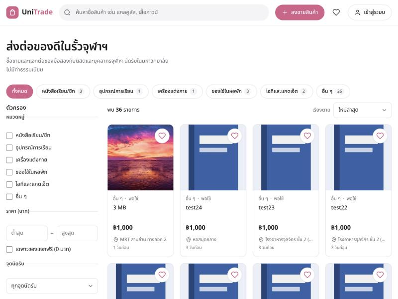
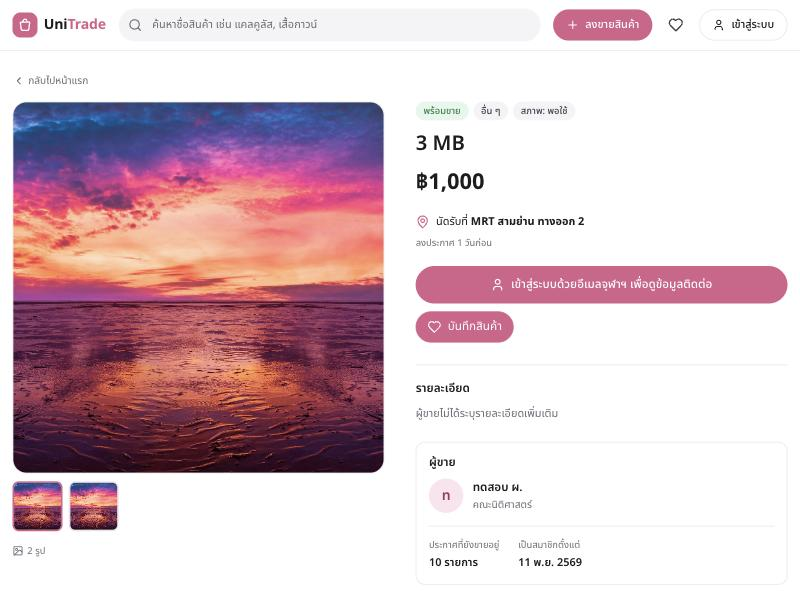
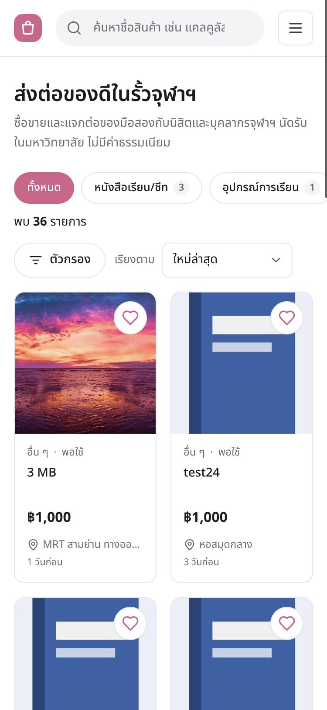

# TASK-23: Deploy ขึ้น Vercel — คู่มือและผลการ deploy

| หัวข้อ | รายละเอียด |
|---|---|
| รหัสงาน | TASK-23 (Deployment: Deploy Frontend ขึ้น Vercel และเชื่อม Domain/DB) |
| Sprint | Sprint 4 |
| ผู้รับผิดชอบ | ยัต -- Frontend Lead |
| สถานะ | **Deploy แล้ว 16 พฤศจิกายน 2569** — Live Demo: **https://unitrade-rouge.vercel.app** · ผลตรวจหลัง deploy อยู่ใน[หัวข้อ 7](#7-ผล-deploy-จริง-16-พฤศจิกายน-2569) |
| อัปเดตล่าสุด | 16 พฤศจิกายน 2569 |

> **หมายเหตุสำคัญ** — ในโปรเจกต์นี้ **หน้าเว็บกับ API อยู่ใน Next.js ตัวเดียวกัน** (Spec §1.1) การ deploy จึงเป็นการ deploy ทั้งระบบพร้อมกันใน 1 โปรเจกต์ Vercel ไม่ได้แยก frontend/backend ชื่องานในชีตเขียนว่า "Deploy Frontend" แต่ผลคือทั้งเว็บและ API ขึ้นพร้อมกัน

---

## 1. ตรวจแล้วว่าพร้อม deploy (ไม่ต้องแก้อะไรเพิ่ม)

| รายการ | สถานะ |
|---|---|
| `npm run build` ผ่านแบบ production | ✅ ผ่าน ไม่มี warning |
| ไม่มี URL ที่ฮาร์ดโค้ด `localhost` / `127.0.0.1` ในโค้ด | ✅ ตรวจแล้วไม่มีเลย — หน้าเว็บเรียก API ด้วย path สัมพัทธ์ `/api/v1` จึงใช้โดเมนไหนก็ได้ ไม่ต้องตั้งค่า |
| `next.config.mjs` | ✅ ไม่ต้องแก้ — Vercel รู้จัก Next.js อยู่แล้ว ไม่ต้องมี `vercel.json` |
| `package.json` → `engines.node: ">=22"` | ✅ ตรงกับ Node 22.x ของ Vercel |
| Storage bucket `product-images` | ✅ migration `0003_storage.sql` ตั้งเป็น public read ไว้แล้ว รูปจึงเปิดจากโดเมน Vercel ได้ ไม่ต้องตั้ง CORS เพิ่ม |
| ไม่มีตัวแปร `NEXT_PUBLIC_` ที่เป็นคีย์ Supabase | ✅ ตรวจแล้ว — มีแค่ `NEXT_PUBLIC_USE_MOCK_API` ซึ่งเป็นสวิตช์ข้อมูลจำลอง ไม่ใช่ความลับ |
| CORS ระหว่างหน้าเว็บกับ API | ✅ ไม่ต้องตั้ง เพราะอยู่โดเมนเดียวกัน |

## 2. ตัวแปรสภาพแวดล้อมที่ต้องใส่ใน Vercel

ใส่ที่ **Project → Settings → Environment Variables** ติ๊กครบทั้ง 3 สภาพแวดล้อม (Production / Preview / Development) ยกเว้นที่ระบุไว้เป็นอย่างอื่น

| ตัวแปร | ค่า | สภาพแวดล้อม | หมายเหตุ |
|---|---|---|---|
| `SUPABASE_URL` | `https://kwvefqgipqagfqhibnjv.supabase.co` | ทั้ง 3 | ค่าเดียวกับใน `.env.example` ไม่ใช่ความลับ |
| `SUPABASE_SERVICE_ROLE_KEY` | secret key จาก Supabase (`sb_secret_…`) | ทั้ง 3 | **ความลับสูงสุด** ขอจาก @wz · ติ๊ก **Sensitive** ตอนใส่ จะได้ไม่ถูกแสดงซ้ำในหน้าเว็บ Vercel |
| `JWT_SECRET` | ค่าเดียวกับที่ทีมใช้อยู่ | ทั้ง 3 | **ต้องเป็นค่าเดียวกันทุกสภาพแวดล้อม** ไม่งั้น token ที่ออกจาก preview จะใช้กับ production ไม่ได้ · ถ้ายังไม่มี สุ่มด้วย `openssl rand -base64 48` |
| `NEXT_PUBLIC_USE_MOCK_API` | **ไม่ต้องใส่เลย** | — | ถ้าเผลอใส่ `true` บน production เว็บจะแสดงสินค้าปลอม 22 ชิ้นแทนของจริง ปลอดภัยที่สุดคือไม่สร้างตัวแปรนี้บน Vercel |

**ห้ามเด็ดขาด** — อย่าเปลี่ยนชื่อตัวแปรใดให้ขึ้นต้นด้วย `NEXT_PUBLIC_` Next.js จะฝังค่าลงไฟล์ JavaScript ที่ส่งให้เบราว์เซอร์ ซึ่งแปลว่าคีย์ `service_role` ที่ข้ามสิทธิ์ทุกชั้นของฐานข้อมูลจะหลุดให้ใครก็ได้อ่าน (`AGENTS.md` หัวข้อ 4.2 ข้อ 5)

## 3. ขั้นตอน deploy

### 3.1 ครั้งแรก

> **ที่ทำจริง (16 พ.ย. 2569)** — repo อยู่ในบัญชี GitHub ส่วนตัวของ @Snow212 คนอื่นจึงติดตั้ง Vercel GitHub App ให้ repo นี้ไม่ได้ เลย deploy ด้วย **Vercel CLI** จากบัญชี Vercel ของยัตแทนขั้นตอน Import ด้านล่าง (รายละเอียดในหัวข้อ 7) ขั้นตอน Import ยังใช้ได้ถ้าเจ้าของ repo จะผูก GitHub ภายหลัง

1. เข้า [vercel.com](https://vercel.com) → **Add New → Project** → เลือก **Import Git Repository** → `maneekongritphichayaporn-creator/UniTrade`
   เจ้าของ repo (@Snow212) ต้องกดอนุญาต Vercel ให้เข้าถึง repo ก่อน
2. หน้าตั้งค่า — ปล่อยค่าอัตโนมัติทั้งหมด ตรวจว่า
   - Framework Preset = **Next.js**
   - Build Command / Output Directory / Install Command = ค่าว่าง (ใช้ค่าเริ่มต้น)
   - Root Directory = `./`
   - Node.js Version = **22.x**
   - **Region = Singapore (sin1)** — ใกล้ผู้ใช้ในไทยและใกล้ Supabase ที่สุด ถ้าเลือก Washington ตามค่าเริ่มต้น ทุกคำขอจะวิ่งข้ามทวีปไปกลับ ช้าขึ้นหลายร้อยมิลลิวินาที
3. ใส่ตัวแปรสภาพแวดล้อมตามตารางหัวข้อ 2 **ก่อนกด Deploy** (ถ้าใส่ทีหลังต้องสั่ง redeploy ใหม่)
4. กด **Deploy** รอประมาณ 2–3 นาที
5. ทำตามรายการตรวจในหัวข้อ 4

### 3.2 ครั้งต่อ ๆ ไป

**แบบที่ใช้อยู่ตอนนี้ (CLI)** — ยังไม่ได้ผูก GitHub จึงต้องสั่ง deploy เองทุกครั้งที่ `main` เปลี่ยน ทำจาก checkout ที่สะอาดของ `main` เท่านั้น (ห้ามมี `.env.local` ที่ตั้ง `NEXT_PUBLIC_USE_MOCK_API=true` ปนไป)

```bash
git worktree add --detach ../unitrade-deploy origin/main
cd ../unitrade-deploy
npx vercel@latest link --yes --project unitrade   # ครั้งแรกครั้งเดียว ต้องล็อกอินบัญชีเจ้าของโปรเจกต์
npx vercel@latest deploy --prod
```

**ถ้าผูก GitHub ได้ภายหลัง** Vercel จะ deploy ให้อัตโนมัติ:

- push เข้า `main` → deploy ขึ้น **Production**
- เปิด PR → ได้ **Preview URL** ของ PR นั้นให้ทดสอบก่อน merge (มีประโยชน์มากตอนรีวิวงาน FE — @wz กดดูหน้าเว็บจริงได้เลยไม่ต้อง clone)

### 3.3 เชื่อม Domain

ถ้าใช้โดเมนที่ Vercel แจกให้ (`unitrade-xxx.vercel.app`) ข้ามหัวข้อนี้ได้เลย ไม่ต้องทำอะไร

ถ้าจะใช้โดเมนของตัวเอง: **Settings → Domains → Add** แล้วตั้งค่าที่ผู้ให้บริการโดเมน
- โดเมนหลัก (`unitrade.com`) → ระเบียน `A` ชี้ไปที่ `76.76.21.21`
- โดเมนย่อย (`www` หรือ `app`) → ระเบียน `CNAME` ชี้ไปที่ `cname.vercel-dns.com`

Vercel ออกใบรับรอง HTTPS ให้เองอัตโนมัติหลัง DNS ชี้ถูก (ปกติไม่เกิน 1 ชั่วโมง) **ไม่ต้องแก้โค้ดหรือตัวแปรใด ๆ ตอนเปลี่ยนโดเมน** เพราะหน้าเว็บเรียก API ด้วย path สัมพัทธ์

### 3.4 เชื่อม Database

ไม่ต้องทำอะไรเพิ่มนอกจากใส่ตัวแปรในหัวข้อ 2 — ฐานข้อมูล Supabase เป็นตัวเดียวกับที่ทีมใช้พัฒนาอยู่แล้ว (migration 0001–0004 รันครบ, seed หมวดหมู่ครบ, bucket ตั้งค่าแล้ว)

**ข้อควรคิดก่อนขึ้นจริง:** ตอนนี้ Vercel ทั้ง production และ preview จะชี้ไปที่ Supabase ตัวเดียวกัน แปลว่าการทดสอบบน preview จะเขียนข้อมูลลงฐานเดียวกับของจริง ถ้าทีมอยากแยก ต้องสร้างโปรเจกต์ Supabase ตัวที่สองแล้วใส่ `SUPABASE_URL` คนละค่าใน Preview — **เรื่องนี้เป็นการตัดสินใจของ @wz ไม่ใช่ของ FE** ขอให้ยกขึ้นคุยในกลุ่มก่อน Sprint 4

## 4. รายการตรวจหลัง deploy (Smoke Test)

ตรวจตามลำดับ ถ้าข้อไหนไม่ผ่านให้หยุดแล้วแก้ก่อน เปลี่ยน `<โดเมน>` เป็นโดเมนจริง

### 4.1 ตรวจ API ด้วย command line

```bash
# 1) หมวดหมู่ต้องได้ 6 หมวด
curl -s https://<โดเมน>/api/v1/categories | head -c 400

# 2) จุดนัดรับต้องได้ 9 แห่ง
curl -s https://<โดเมน>/api/v1/pickup-locations

# 3) รายการสินค้าต้องมี data กับ pagination
curl -s "https://<โดเมน>/api/v1/products?per_page=2" | head -c 500

# 4) สินค้าที่ไม่มีจริงต้องได้ 200 พร้อม {"data":[]} ไม่ใช่ 500
curl -s -o /dev/null -w "%{http_code}\n" https://<โดเมน>/api/v1/products/not-a-uuid

# 5) เส้นที่ต้องล็อกอินต้องได้ 401 ไม่ใช่ 500
curl -s -o /dev/null -w "%{http_code}\n" https://<โดเมน>/api/v1/auth/me
```

### 4.2 ตรวจความปลอดภัย — สำคัญที่สุด

```bash
# คีย์ Supabase ต้องไม่โผล่ในไฟล์ JavaScript ที่ส่งให้เบราว์เซอร์
curl -s https://<โดเมน>/ | grep -oE '/_next/static/chunks/[^"]+\.js' | sort -u | head -40 \
  | while read f; do curl -s "https://<โดเมน>$f"; done \
  | grep -ciE 'service_role|sb_secret|eyJhbGciOiJIUzI1NiIsInR5cCI6IkpXVCJ9'
# ต้องได้ 0
```

```bash
# ข้อมูลติดต่อต้องไม่หลุดมากับรายละเอียดสินค้า (FR-06)
curl -s "https://<โดเมน>/api/v1/products/<product_id จริง>" | grep -ciE 'phone_number|line_id|"email"'
# ต้องได้ 0
```

### 4.3 ตรวจหน้าเว็บด้วยตา

- [ ] เปิด `https://<โดเมน>/` เห็นสินค้าจริงจากฐานข้อมูล **ไม่ใช่สินค้าจำลอง 22 ชิ้น** (ถ้าเห็นสินค้าจำลอง แปลว่า `NEXT_PUBLIC_USE_MOCK_API` ถูกตั้งไว้บน Vercel — ลบทิ้งแล้ว redeploy)
- [ ] รูปสินค้าขึ้นครบ ไม่ขึ้นรูปแทน (ถ้าไม่ขึ้น แปลว่า bucket ไม่ public)
- [ ] ค้นหาคำไทยได้ · กรองหมวดหมู่ได้ · เปลี่ยนหน้าได้
- [ ] กดการ์ดเข้าหน้ารายละเอียด เห็นรูปและข้อมูลผู้ขาย
- [ ] กดปุ่มติดต่อตอนยังไม่ล็อกอิน → ไปหน้าเข้าสู่ระบบ แล้วเด้งกลับมาหน้าเดิมได้
- [ ] เปิดบนมือถือจริง 1 เครื่อง ตรวจว่า Navbar ยุบและตัวกรองเปิดได้
- [ ] เปิด DevTools → Console ต้องไม่มี error สีแดง
- [ ] เปิด path มั่ว เช่น `/abcxyz` → เห็นหน้า 404 ของเรา ไม่ใช่หน้า error ของ Next.js

### 4.4 ถ้าต้องย้อนกลับ

Vercel → **Deployments** → เลือกตัวที่เคยใช้งานได้ → **⋯ → Promote to Production** ใช้เวลาไม่กี่วินาที ไม่ต้อง revert git

## 5. ปัญหาที่คาดไว้ล่วงหน้า

| อาการ | สาเหตุ | ทางแก้ |
|---|---|---|
| หน้าเว็บขึ้นแต่สินค้าว่างเปล่า ทั้งที่ฐานข้อมูลมีของ | ตัวแปร Supabase ยังไม่ได้ใส่ หรือใส่แล้วไม่ได้ redeploy | ใส่ให้ครบแล้ว Deployments → Redeploy |
| เห็นสินค้า 22 ชิ้นเหมือนตอนพัฒนา | `NEXT_PUBLIC_USE_MOCK_API=true` ติดไปบน Vercel | ลบตัวแปรทิ้งแล้ว redeploy |
| ล็อกอินแล้วเด้งออกทันที หรือ token ใช้ไม่ได้ข้าม preview/production | `JWT_SECRET` คนละค่ากันระหว่างสภาพแวดล้อม | ตั้งให้เป็นค่าเดียวกันทั้ง 3 สภาพแวดล้อม |
| อัปโหลดรูปตอนลงประกาศแล้วได้ 413 | Vercel ปฏิเสธ request body เกิน 4.5 MB ทุกแพ็กเกจ | **ต้องย่อรูปฝั่งเบราว์เซอร์ก่อนส่ง** เป็นงานของ TASK-13 (@warixm) ดู `AGENTS.md` หัวข้อ 8.1 — จะไม่เจอตอนทดสอบบนเครื่องตัวเอง แต่เจอแน่บน production |
| รูปสินค้าไม่ขึ้น ขึ้นแต่รูปแทน | bucket `product-images` ไม่ได้เป็น public | ตรวจว่า migration `0003_storage.sql` รันแล้ว |
| หน้าแรกช้าผิดปกติ | Region ของ Vercel อยู่คนละทวีปกับ Supabase | Settings → Functions → เปลี่ยนเป็น Singapore แล้ว redeploy |
| ทุกหน้าได้ 404 รวมหน้าแรกและ `/api/v1/*` ทั้งที่ build ผ่าน | สร้างโปรเจกต์ผ่าน CLI แล้ว Framework Preset ว่าง Vercel จึงไม่รู้ว่าเป็น Next.js (เจอจริงตอน deploy ครั้งแรก) | Settings → Build and Deployment → Framework Preset = **Next.js** แล้ว redeploy |
| ได้ 500 ทุก endpoint ที่อ่านฐานข้อมูล แต่ `/pickup-locations` ได้ 200 | ยังไม่ได้ใส่ตัวแปรในหัวข้อ 2 หรือใส่แล้วยังไม่ redeploy (หน้าสมัครสมาชิกจะขึ้น "เกิดข้อผิดพลาดในระบบ") | ใส่ตัวแปรให้ครบแล้ว redeploy |
| Build พังบน Vercel แต่ผ่านบนเครื่อง | `.next` ของเก่าค้างบนเครื่อง ทำให้ไม่เจอ error จริง | ลองซ้ำด้วย `rm -rf .next && npm run build` บนเครื่องก่อน push |

## 6. สิ่งที่ต้องรอก่อนขึ้น production จริง (ปิดแล้ว)

ตอนเขียนคู่มือ (3 พ.ย.) ยังรอ TASK-08, 13, 14, 17, 19, 20 และ `GET /products/:id/contact` ทุกข้อเสร็จและ merge เข้า `main` ก่อนวัน deploy แล้ว (PR #9–#14 และ API ของ @wz เมื่อ 15 พ.ย.) จึง deploy ขึ้น production ได้เต็มระบบ

## 7. ผล deploy จริง (16 พฤศจิกายน 2569)

| หัวข้อ | ค่า |
|---|---|
| **Live Demo** | **https://unitrade-rouge.vercel.app** (โดเมน production ของโปรเจกต์ คงที่ทุกครั้งที่ redeploy) |
| โปรเจกต์ Vercel | `unitrade` ในบัญชี Vercel ของยัต (แพ็กเกจ Hobby) |
| วิธี deploy | Vercel CLI 65.16 (`vercel deploy --prod`) จาก checkout ที่สะอาดของ `main` commit `a5ee440` — ยังไม่ได้ผูก GitHub (เหตุผลในหัวข้อ 3.1) |
| ตั้งค่าโปรเจกต์ | Framework Preset = Next.js · Node.js 22.x · Function region = Singapore (`sin1`) |
| ตัวแปรสภาพแวดล้อม | `SUPABASE_URL`, `SUPABASE_SERVICE_ROLE_KEY`, `JWT_SECRET` — Production + Preview แบบ Sensitive · ไม่มี `NEXT_PUBLIC_USE_MOCK_API` |
| ฐานข้อมูล | Supabase ตัวเดียวกับที่ทีมใช้พัฒนา (migration 0001–0005) |

### 7.1 ผล smoke test (ตรวจ 16 พ.ย. 2569 เวลา 13:55 น.)

| # | รายการตรวจ | ผลที่ได้ | ผ่าน |
|---|---|---|---|
| 1 | หน้า `/`, `/login`, `/register` | 200 ทุกหน้า | ✅ |
| 2 | path ที่ไม่มีจริง `/abcxyz` | 404 หน้า Not found ของระบบ | ✅ |
| 3 | `GET /api/v1/categories` | 200 · 6 หมวด (Textbooks … Other) | ✅ |
| 4 | `GET /api/v1/pickup-locations` | 200 · 9 จุด | ✅ |
| 5 | `GET /api/v1/products?status=all` | 200 · สินค้าจริงจากฐานข้อมูล 37 รายการ พร้อม `pagination` | ✅ |
| 6 | `GET /api/v1/products/not-a-uuid` | 200 · `{"data":[]}` ไม่ใช่ 500 | ✅ |
| 7 | `GET /api/v1/auth/me`, `GET /api/v1/me/wishlist` ไม่แนบ token | 401 ทั้งคู่ | ✅ |
| 8 | `GET /api/v1/products/:id/contact` ไม่แนบ token | 401 `UNAUTHORIZED` | ✅ |
| 9 | `GET /api/v1/products/:id` และรายการสินค้า มี `phone_number` / `line_id` / `email` / `password_hash` ไหม (FR-06) | ไม่พบเลย (0) · `seller` มีแค่ `user_id`, `full_name` (ชื่อย่อ), `faculty`, `created_at`, `active_listings` | ✅ |
| 10 | ไฟล์ JavaScript ฝั่งเบราว์เซอร์ทั้ง 14 ไฟล์ (จาก 6 หน้า) มี `sb_secret_`, `service_role`, `JWT_SECRET`, URL ของ Supabase project หรือ `createClient` ไหม | ไม่พบเลย (0 ทุกคำ) — ไม่มี Supabase client ในเบราว์เซอร์ | ✅ |
| 11 | HTTPS | TLS 1.3, ใบรับรอง `*.vercel.app` (Google Trust Services), มี HSTS | ✅ |
| 12 | Region | `x-vercel-id: sin1::sin1::…` — ทั้ง edge และ function อยู่สิงคโปร์ | ✅ |
| 13 | หน้าแรกใช้ข้อมูลจริง ไม่ใช่ mock | เบราว์เซอร์เรียก `/api/v1/categories`, `/pickup-locations`, `/products` จริง · ไม่มีสินค้าจำลอง `c0ffee00-…` · รูปโหลดจาก Supabase Storage ได้ | ✅ |
| 14 | หน้ารายละเอียดสินค้าตอนยังไม่ล็อกอิน | แสดงรูป ราคา จุดนัดรับ ข้อมูลผู้ขายแบบสาธารณะ และปุ่ม "เข้าสู่ระบบด้วยอีเมลจุฬาฯ เพื่อดูข้อมูลติดต่อ" ที่พาไป `/login?next=…` | ✅ |
| 15 | หน้าจอมือถือ (375 px) | Navbar ยุบเป็นปุ่มเมนู ตัวกรองเป็นปุ่มแยก การ์ด 2 คอลัมน์ | ✅ |

**ยังไม่ได้ตรวจในรอบนี้:** สมัครสมาชิก → ล็อกอิน → กดดูข้อมูลติดต่อผู้ขาย บน production ต้องใช้บัญชีจริงและสร้างข้อมูลลงฐานข้อมูลร่วม จึงให้สมาชิกทีมทดสอบด้วยบัญชีของตัวเอง (ผล QA บนเครื่องของ @Aud เมื่อ 12 พ.ย. ผ่านทุกเคส)

### 7.2 ภาพหน้าจอ

| หน้าแรก (desktop) | รายละเอียดสินค้า | หน้าแรก (มือถือ) |
|---|---|---|
|  |  |  |

### 7.3 ปัญหาที่เจอระหว่าง deploy และวิธีแก้

1. **ทุกหน้าได้ 404** — โปรเจกต์ที่สร้างผ่าน CLI ได้ Framework Preset ว่าง และ Node.js 26.x / region Washington (`iad1`) เป็นค่าเริ่มต้น แก้เป็น Next.js / 22.x / `sin1` แล้ว redeploy
2. **API ที่อ่านฐานข้อมูลได้ 500** (หน้าสมัครสมาชิกขึ้น "เกิดข้อผิดพลาดในระบบ กรุณาลองใหม่อีกครั้ง") — ยังไม่ได้ใส่ตัวแปรในหัวข้อ 2 ใส่ครบแล้ว redeploy จึงหาย อาการเดียวกันนี้เกิดตอนรันบนเครื่องที่ไม่มี `SUPABASE_SERVICE_ROLE_KEY` ใน `.env.local`
3. **deploy ครั้งแรกขึ้น Production ทันที** — Vercel ถือว่า deployment แรกของโปรเจกต์ใหม่เป็น production เสมอ แม้สั่งแบบ preview

### 7.4 ครั้งต่อไปที่ต้อง redeploy

- หลัง PR #18 (ปิดปุ่มติดต่อผู้ขายเมื่อสินค้า Sold) merge เข้า `main` — ยัตจะ redeploy ตามหัวข้อ 3.2
- ถ้า @wz เปลี่ยน `SUPABASE_SERVICE_ROLE_KEY` หรือ `JWT_SECRET` ต้องแก้ใน Vercel แล้ว redeploy (เปลี่ยน `JWT_SECRET` จะทำให้ทุกคนต้องล็อกอินใหม่)
